# Fat-Tree Network Topology

Homework 1, course 361.2.2460 — Data Center & AI Networking (BGU, semester A 2026/27).

Implements and analyzes a three-tier fat-tree data center topology, consistent with:

> M. Al-Fares, A. Loukissas, A. Vahdat, "A Scalable, Commodity Data Center Network
> Architecture," SIGCOMM Comput. Commun. Rev., vol. 38, no. 4, pp. 63–74, Oct. 2008,
> doi:[10.1145/1402946.1402967](https://doi.org/10.1145/1402946.1402967).

## Approach

This is a **graph/flow-level simulation**, not a packet-level emulator for the
large-scale experiments (the paper's own evaluation used Click; most of this
repo's results use a graph-only or max-min-fair flow model instead, for speed at
large `k`). A genuine discrete-event **packet-level** engine also exists
(`fattree/sim/packet.py`) for the small-`k` micro-behavior questions it's suited
to — see [Simulation levels](#simulation-levels) below for when each is used and
why. The topology, addressing, and failure model are built on top of
[networkx](https://networkx.org/): switches and hosts are graph nodes, links are
edges, and failures are modeled as node/edge removal.

The topology generator (`fattree/topology.py`) reproduces the paper's three-tier
structure (core / aggregation / edge / hosts) and its IP addressing scheme (Sec. 3.2),
including the agg-switch-to-core-row connection rule and the Fig. 3 worked example,
which are both covered by `tests/test_topology.py`. Traffic patterns
(`fattree/traffic.py`), five routing schemes including the paper's actual two-level
algorithm (`fattree/routing/`), and three simulation engines (`fattree/sim/`) are
layered on top.

## Repository layout

```
fattree/
  topology.py    # build k-ary fat-tree + traditional tree, paper addressing, validate()
  failures.py    # link + switch failures, per layer, exact/bernoulli, fixed or randomized pct
  config.py      # config loading, defaults, validation
  metrics.py     # switches-with-failed-links metric + closed-form theory
  traffic.py     # 8 traffic patterns (paper Sec. 5.2) + flow-size/class models
  routing/       # single-path, ecmp, two-level (paper Alg. 1/2), classifier (Alg. 3), scheduler
  sim/
    graph.py          # structure-only connectivity/path metrics (edge-switch aggregation trick)
    flow.py           # max-min fair rate allocation (progressive filling)
    packet.py         # discrete-event packet simulator engine, k <= 8 only
    transport.py       # udp (open-loop) and tcp_lite (Reno-like, RFC 6298 RTO) state machines
    packet_metrics.py  # per-packet/flow/port stats, RFC 4737 reordering
config/
  default.yaml   # one scenario
run.py           # CLI: build a topology, apply failures, print a summary
visualize.py     # CLI: topology diagram, failure summary chart, experiment plots
analysis.py      # CLI: experiment subcommands -> results/*.csv + figures/*.png
figures/         # PNG diagrams and plots (committed)
results/         # CSV experiment output (committed)
tests/           # pytest: topology, failures, config, traffic, routing, sim, metrics
```

Not built: the `web/` GitHub Pages interactive site, and 5 of the 9 experiments
in `PHASE2_PROMPT.md` (noted individually under [Results](#results) and
[Not done / future work](#not-done--future-work) below) given the submission deadline.

## Topology diagram

```bash
python visualize.py --k 8 --link-pct 5 --seed 1 --out figures/topology_k8_failures.png
python visualize.py --k 4 --no-failures --out figures/topology_k4_clean.png
```

Layers (core/agg/edge/host) are stacked top to bottom, pods grouped left to right.
Failed links are dashed red; failed switches would be marked with a red ×.

`k=4`, no failures (matches the paper's Fig. 3 worked example):


`k=8`, 5% of edge-agg/agg-core links failed (seed 1, exact mode — 13 of 256 eligible links):


`visualize.py` also writes a small summary chart next to the diagram: a pie of link
status (alive vs. failed) and a bar chart of switch/link counts before vs. after
failure, labeled with the resolved failure percentages:


## Traditional tree (comparison baseline)

`topology.type` (`--topology-type`) also accepts `traditional-tree`: a conventional,
oversubscribed 3-tier tree with the *same host count* as the fat-tree (paper Sec. 2 /
Fig. 1) — one aggregation switch per pod and a single core switch for the whole
network, so there is exactly **one** path between any two hosts, instead of the
fat-tree's `(k/2)²` parallel core paths. Hop counts are identical to the fat-tree
(2/4/6 for same-edge/same-pod/cross-pod); what differs is redundancy, not path length.

```bash
python visualize.py --k 8 --topology-type traditional-tree --link-pct 5 --seed 1 \
    --out figures/topology_traditional_k8.png --summary-out figures/summary_traditional_k8.png
```


With only 5% of links failed, a single unlucky edge-agg link (dashed red, above)
cuts off an entire edge switch's worth of hosts — in the fat-tree diagram above,
the same failure rate barely dents connectivity because every edge/agg switch has
`k/2` parallel uplinks. `tests/test_topology.py::test_traditional_tree_has_no_redundant_paths`
checks this directly by removing one edge-agg link and asserting those hosts become
unreachable.

## Routing schemes

`fattree/routing/` implements five schemes behind one `Router` interface
(`route(flow)`, `on_failure(...)`, `stats()`):

- **single-path** — one fixed shortest path per destination, computed once and
  never recomputed; a failure on that path simply drops the flow (OSPF-like
  baseline, no multi-path diversity).
- **ecmp** — hashes each flow onto one of the currently available equal-cost
  shortest paths; since it recomputes live over the current (post-failure)
  graph on every call, it reroutes automatically.
- **two-level** — the paper's actual algorithm (Sec. 3.3–3.5, Algorithms 1 and
  2, with the documented destination-pod typo in Algorithm 2 fixed). Builds
  real prefix/suffix forwarding tables per switch; the agg→core port-to-core
  wiring was reverse-engineered from the paper's own worked example and
  verified to reproduce it exactly (`tests/test_routing.py::test_two_level_matches_paper_fig3_example`).
  Static by default (`two_level.failover: false` — a failure on the table-driven
  path just drops the flow, matching the paper's Sec. 3.1 critique of this
  weakness); `failover: true` approximates Sec. 3.8's reroute-when-a-choice-exists
  behavior.
- **classifier** — Algorithm 3: new flows go to the least-loaded upward port;
  periodically, up to `classifier.max_moves` flows move from the most- to the
  least-loaded port if that reduces the imbalance.
- **scheduler** — Sec. 3.7/4.3: a central scheduler reserves one of the
  `(k/2)²` inter-pod core paths (or `k/2` intra-pod agg paths) per elephant
  flow (`traffic.elephant_threshold_bytes`); mice use two-level.

## Simulation levels

`simulation.level` picks the engine (`fattree/sim/`), trading fidelity for
speed — the paper used packet-level Click emulation throughout; this repo
instead picks the *cheapest* level that still answers each question, since a
full packet simulation at `k=48` (27,648 hosts) is not tractable in reasonable
time with a Python discrete-event loop:

- **graph** — structure only, no traffic or routing. Fast enough for `k=48` in
  under a second (`fattree/sim/graph.py`'s edge-switch aggregation trick — see
  its docstring). Used for `critical_failure_pct_vs_k` and `link_vs_switch`.
  Limitation: no notion of load, capacity, or congestion.
- **flow** — routes every flow, then computes max-min fair rates (progressive
  filling) over link capacities. No queueing: a congested link's flows share it
  perfectly and instantly, with no buildup or loss. Used for `table2_reproduction`
  and `throughput_vs_failures`. Limitation: cannot show queueing delay, drops,
  or reordering.
- **packet** — genuine discrete-event simulation, integer-nanosecond clock
  (FIFO drop-tail queues, store-and-forward, `udp` open-loop or `tcp_lite`
  Reno-like reliable transport with RFC 6298 RTO), restricted to `k ≤ 8` since
  it is the slowest engine by orders of magnitude. The right tool for
  queueing/drop/reordering/FCT/timeout questions — used for
  [Experiment 9 (Incast)](#experiment-9-incast) and
  [Experiment 7 (Mice vs. elephants)](#experiment-7-mice-vs-elephants) below,
  and exercised directly by `tests/test_packet_sim.py`'s 13 required
  validation tests (exact delay formulas, queue-overflow drop counts, an M/D/1
  queueing-theory check, reordering under spraying, etc.). Limitation: no
  SACK, no delayed ACKs, no ECN, simplified fast recovery (see the Incast and
  Mice vs. elephants results for how this shows up).

## Input parameters

Set via `config/default.yaml` (or any `-c <path>`), overridable on the command line.

| Parameter                | Config path            | CLI flag        | Default | Meaning |
|---------------------------|-------------------------|------------------|---------|---------|
| Switch port count          | `topology.k`            | `--k`            | 8       | Must be one of `allowed_k` below. Determines every other count: `k³/4` hosts, `5k²/4` switches, `k³/4` links per layer. |
| Allowed port counts         | `allowed_k`              | —                | `[4, 8, 16, 24, 32, 48, 64]` | Real switch port counts; `topology.k` and any `sweep.values` for `topology.k` must come from this list, or a clear error names the list (e.g. `k=25 is not allowed; choose one of 4, 8, 16, 24, 32, 48, 64`). |
| Topology type               | `topology.type`         | `--topology-type`| `fat-tree` | `fat-tree \| traditional-tree`. The latter is a conventional oversubscribed tree with the same host count, for comparison — see below. |
| Link failure %             | `failures.link_pct`     | `--link-pct` / `--link-pct-range MIN MAX` | 1       | % of links removed. Either a fixed number, or a `[min, max]` range (e.g. `[0, 20]`) to pick a random pct each run, drawn from the seeded RNG so it stays reproducible. |
| Switch failure %           | `failures.switch_pct`   | `--switch-pct` / `--switch-pct-range MIN MAX` | 0       | % of switches removed (with their incident links). Same fixed-or-range option as `link_pct`. |
| Failure layers (links)     | `failures.link_layers`  | —                | `[edge-agg, agg-core]` | Which link layers are eligible to fail. |
| Failure layers (switches)  | `failures.switch_layers`| —                | `[core, agg, edge]`    | Which switch layers are eligible to fail. |
| Failure mode                | `failures.mode`         | `--mode`         | `exact` | `exact` = `round(pct·N)` chosen uniformly without replacement; `bernoulli` = each element fails independently with probability `p = pct/100`. |
| Traffic pattern            | `traffic.pattern`       | `--pattern`      | `random` | `random \| stride \| staggered \| same-pod \| all-to-all \| incast \| inter-pod-incoming \| same-id-outgoing` — see `fattree/traffic.py`. |
| Flow size model             | `traffic.size_model`    | —                | `mice-elephants` | `fixed \| mice-elephants \| empirical`; controls flow sizes and mouse/elephant classification (`traffic.elephant_threshold_bytes`). |
| Offered load                | `traffic.load`          | `--load`         | 1.0     | Each host sends at `load × link rate`. |
| Routing scheme              | `routing`                | `--routing`      | `two-level` | `single-path \| ecmp \| two-level \| classifier \| scheduler` — see [Routing schemes](#routing-schemes). |
| Simulation level             | `simulation.level`      | —                | `flow`  | `graph \| flow \| packet` (packet only for `k <= 8`) — see [Simulation levels](#simulation-levels). |
| Random seed                 | `seed`                   | `--seed`         | 1       | Every random choice is seeded; trial `t` uses `seed + t`. |
| Trials per config point      | `trials`                 | `--trials`       | 30      | Repetitions for sweeps. |

Config and CLI are validated with explicit errors (odd `k`, out-of-range percentages,
unknown pattern/routing/mode, ...) — see `fattree/config.py`. The full traffic/routing/
packet config schema (20+ additional keys: `subnet_p`, `incast_senders`,
`elephant_fraction`, `two_level.failover`, `classifier.max_moves`,
`packet.transport`, `packet.spraying`, ...) is documented inline in
`config/default.yaml`, not duplicated here.

## Install & run

```bash
python3 -m venv .venv && source .venv/bin/activate
pip install -r requirements.txt

# run the default scenario
python run.py -c config/default.yaml

# override parameters on the command line
python run.py -c config/default.yaml --k 16 --link-pct 10

# randomize the failure pct per run instead of a fixed value (seeded, reproducible)
python run.py -c config/default.yaml --link-pct-range 0 20 --seed 7

# build the traditional-tree comparison baseline instead of the fat-tree
python run.py -c config/default.yaml --topology-type traditional-tree

# machine-readable summary
python run.py -c config/default.yaml --json

# draw the topology + a small pie/bar failure summary chart
python visualize.py -c config/default.yaml --out figures/topology.png --summary-out figures/summary.png

# experiments (analysis.py subcommands; see Results below for each one's write-up)
python analysis.py switches-multifail --ks 4 8 16 24 32 --p 1 --trials 30 --seed 1
python analysis.py critical-failure-pct --ks 4 8 16 24 32 --trials 10
python analysis.py table2 --k 4 --trials 15
python analysis.py throughput-vs-failures --ks 8 16 --pcts 0 5 10 15 20 25 30 --trials 15
python analysis.py link-vs-switch --k 16 --pcts 0 1 2 5 10 15 20 --trials 15
python analysis.py incast --k 4 --ms 1 2 4 8 15 --queue-sizes 32 64 128 --rounds 10 --trials 5
python analysis.py mice-elephants --k 4 --loads 0.3 0.5 0.7 --trials 3
```

Example output:

```
Topology: fat-tree, k=8
  hosts:    128
  switches: 80
  links:    384
  failures: 0 switches, 3 links (link_pct=1%, switch_pct=0%, exact mode)
  after failure: 80 switches, 381 links
```

## Tests

```bash
python -m pytest tests/ -v
```

Covers: topology counts vs. the paper's closed-form formulas (`k³/4` hosts, `5k²/4`
switches, `k³/4` links per layer) for `k ∈ {4, 6, 8}`; the paper's Fig. 3 worked
addressing example; shortest-path hop counts (2/4/6 hops for same-edge/same-pod/
cross-pod host pairs); failure-count correctness and determinism under a fixed seed
(including randomized `[min, max]` failure-pct ranges); config validation/merging;
the traditional-tree baseline's counts, connectivity, and lack of path redundancy;
the switches-with-failed-links metric against a brute-force enumeration of all
`2^k` failure patterns for small k; all 8 traffic patterns' structural properties
(bijection/derangement, stride correctness, per-pattern invariants) and flow-size
class fractions; every routing scheme (valid/deterministic paths, failure
behavior, and the two-level router against the paper's own Fig. 3 worked
example); and all three simulation levels, including `fattree/sim/graph.py`'s
metrics against brute-force host-pair BFS across several `k`/failure
combinations, `fattree/sim/flow.py`'s max-min fairness against the classic
asymmetric-bottleneck textbook example, and `fattree/sim/packet.py`'s exact
delay/drop/reorder/retransmission properties (see Results below). 194 tests,
all passing.

## Results

### Switches with multiple failed links vs. switch port count

This is the assignment's "intermediate" example metric (Sec. 5): *"Number of
switches with multiple failed links (at a 1% failure rate) as a function of switch
port count."*

**Setup.** For each `k` in `allowed_k` up to 32 (`{4, 8, 16, 24, 32}` — real switch
port counts, config `allowed_k`, PHASE2_PROMPT.md Step 1), build a fat-tree and fail
each of its links independently with probability `p = 1%` (bernoulli mode, across
all three link layers so every switch's `k` ports are equally exposed —
`--link-layers` defaults to `edge-agg`/`agg-core` only, but this experiment needs
host-edge included too, since the metric is about a switch's *total* port count).
Repeat for 30 seeded trials per `k` (`seed + t`) and take the mean and 95% CI.
Compare against the closed-form prediction (CLAUDE.md §6), since every switch has
exactly `k` ports:

```
P(≥2 of k ports fail) = 1 - (1-p)^k - k·p·(1-p)^(k-1)
```

Reproduce with `python analysis.py switches-multifail --ks 4 8 16 24 32 --p 1 --trials 30 --seed 1`
(any subset of `allowed_k` works, including 48/64) → `results/switches_multifail_vs_k.csv`
+ the plot below.


**Discussion.** The Monte-Carlo simulation tracks the closed-form curve closely at
every `k`, within its 95% CI — this is both a correctness check on the failure
model (`fattree/failures.py` bernoulli mode genuinely applies independent per-link
probability `p`) and a demonstration of how fast multi-failure exposure grows with
port count. At `k=4` a switch's 4 ports almost never see 2 failures at `p=1%`
(≈0.01 switches network-wide); by `k=32` the same per-link rate yields over 50
switches with ≥2 failed links on average. This matters because a switch with ≥2
failed links is the precursor to a *structural* break: in the fat-tree a single
failed uplink is absorbed by ECMP across the remaining `k/2 - 1` parallel paths,
but a switch losing multiple ports simultaneously shrinks its usable fan-out and
raises the chance that *all* paths through it are gone — which is exactly the
scenario the `link-vs-switch` experiment below quantifies directly.
It also explains why larger (`higher-radix`) fat-trees, despite offering more raw
bisection bandwidth, need proportionally more aggressive failure monitoring: the
same per-link failure rate produces a disproportionately larger multi-failure
switch population as `k` grows, since this is a ≈`k²·p²` effect (choose 2-of-`k`
ports, each ∝ `p`).

### Throughput vs. link failure probability, by routing scheme

This is the assignment's "advanced" example metric (Sec. 5): a non-trivial
performance metric as a function of failure probability — here, achieved
throughput (flow level) rather than path length, since it captures both
connectivity *and* capacity loss in one number and directly separates the five
routing schemes by how gracefully they degrade.

**Setup.** For `k ∈ {8, 16}`, link failure % ∈ `{0, 5, 10, 15, 20, 25, 30}`
(bernoulli, edge-agg + agg-core), 15 seeded trials per point, `random` traffic,
flow level: build the topology, apply failures, build each of 5
routers/configurations on the *post-failure* graph (two-level, two-level with
`failover: true`, ecmp, classifier, scheduler), route all flows, and measure
throughput as % of ideal (`fattree/sim/flow.py`).

Reproduce: `python analysis.py throughput-vs-failures --ks 8 16 --pcts 0 5 10 15 20 25 30 --trials 15`
→ `results/throughput_vs_failures.csv` + the plot below.

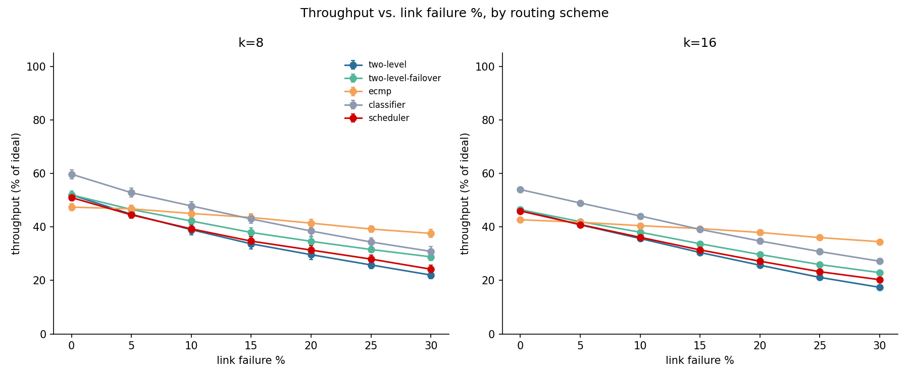

**Discussion.** All five schemes decline roughly linearly with failure %, but
at very different rates — exactly the "how gracefully does it degrade" question
this metric is designed to expose. **ECMP degrades slowest** (k=8: 47.4%→37.6%
from 0%→30% failure, a 20.7% relative drop; k=16: 42.7%→34.5%, a 19.2% drop)
because it recomputes shortest paths fresh on every call, so it automatically
routes around failed links whenever an equal-cost alternative exists — the
fat-tree's built-in path redundancy is directly visible here. **Plain
two-level degrades fastest** (k=8: 52.0%→22.0%, a 57.7% relative drop) because
its tables are static: a flow whose table-driven hop crosses a failed link is
simply dropped, with no attempt to use the `k/2 - 1` other equally-valid
upward ports that may still be alive. **Enabling `two_level.failover`
recovers a meaningful fraction of that gap** (k=8 at 30% failure: 22.0% static
vs. 28.8% with failover, a 6.8-point recovery) by retrying another live port
at the same switch instead
of dropping outright — direct, quantitative evidence for the paper's own
Sec. 3.8 motivation for adding failover to an otherwise-static scheme.
**Classifier starts highest and stays highest** at every failure level (its
least-loaded-port placement already does better load balancing than the
fixed host-ID formula even at 0% failure, and that advantage persists under
failure), while **scheduler tracks close to plain two-level** — its reserved
elephant paths help throughput at the margins but do not fundamentally change
how it reacts to a failed link along a chosen path. The comparison across `k`
is also informative: every curve is lower at `k=16` than at `k=8` at the same
failure %, since `random` permutation traffic scatters more flows across more
possible hotspots as the network grows, even though (per the critical-failure-%
experiment above) the *same* `k=16` network is far more resistant to losing
connectivity outright — throughput degrades gracefully long before
connectivity collapses.

### Critical link failure % vs. switch port count

**Setup.** For each `k ∈ {4, 8, 16, 24, 32}`, binary-search (resolution 1%,
range 0–99%) the smallest *link* failure % (bernoulli, edge-agg + agg-core)
at which mean host-pair connectivity (`fattree/sim/graph.py`, 10 seeded trials
per candidate %) drops below 99.9%, and separately below 99%. This is the
graph level (no traffic/routing needed), so it scales to `k=32` in well under a
minute; `k=48` also works (~3–4 min) via `--ks 4 8 16 24 32 48`.

Reproduce: `python analysis.py critical-failure-pct --ks 4 8 16 24 32 --trials 10`
→ `results/critical_failure_pct_vs_k.csv` + the plot below.

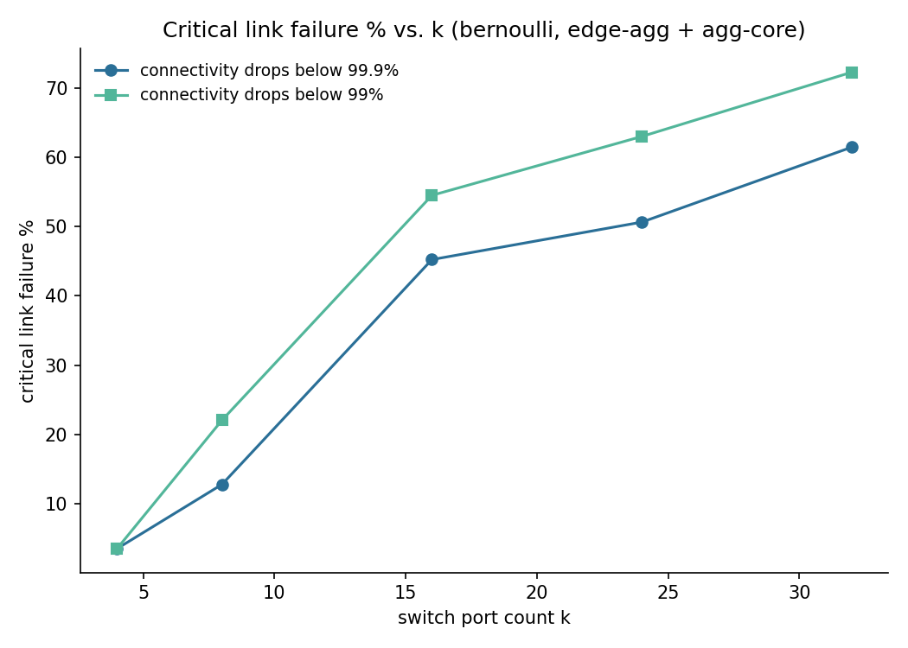

**Discussion.** The critical percentage rises sharply with `k`: from ~3.5% at
`k=4` to ~61% (99.9% threshold) / ~72% (99% threshold) at `k=32`. This is the
flip side of the previous experiment — a fat-tree's *raw* exposure to
multi-failure switches grows with `k`, but its actual host-pair connectivity is
far more robust at large `k`, because disconnecting a host pair requires
wiping out *all* `(k/2)²` core paths between their pods, and `(k/2)²` grows
quadratically while independent link failures only degrade that redundancy
linearly in expectation. This is a direct, quantitative illustration of why
the paper's Clos-based design scales: adding ports doesn't just add hosts, it
adds *disproportionately more* fault tolerance per unit of failure probability.
The practical reading for an operator: a fixed "redundant 5% of links are
down" monitoring threshold is far more alarming at `k=4` than at `k=32` — the
acceptable operating envelope widens with scale.

### Link failures vs. switch failures at equal %

**Setup.** At `k=16`, for `pct ∈ {0, 1, 2, 5, 10, 15, 20}`, compare two
failure types at the *same* percentage (bernoulli, 15 seeded trials each):
pure link failures (edge-agg + agg-core) vs. pure switch failures (edge + agg).
Two metrics, both graph-level: fraction of host pairs connected, and inter-pod
path diversity (`path_diversity`, pods 0 and 1, surviving shortest paths /
`(k/2)²`).

Reproduce: `python analysis.py link-vs-switch --k 16 --pcts 0 1 2 5 10 15 20 --trials 15`
→ `results/link_vs_switch_failures.csv` + the plot below.

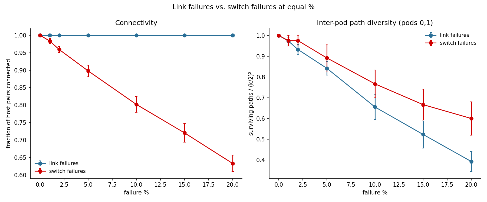

**Discussion.** On *connectivity*, switch failures are dramatically more
damaging: at 20% switch failure, connectivity has dropped to ~63%, while 20%
*link* failure leaves connectivity essentially untouched (>99.9%) at `k=16` —
consistent with the previous experiment's finding that `k=16` needs ~45% link
failure just to cross the 99.9% threshold. The reason is each switch failure's
"blast radius": removing one edge or agg switch deletes `k` or `k/2` links at
once (and, for an edge switch, isolates its `k/2` directly-attached hosts
outright), so a given failure *percentage* of switches removes far more total
connectivity than the same percentage of links. On *path diversity* between a
fixed pod pair, the two curves are closer and link failures are actually
*slightly* worse at high %, because the diversity metric only counts paths
between two specific pods — independent link failures spread evenly cut into
every one of the `(k/2)²` paths a little, while switch failures are "lumpier"
(concentrated on whichever switches happen to fail) and so are somewhat more
likely to leave some fully-intact paths untouched. Together these two panels
make the case from `CLAUDE.md` §6 concrete: "link failures vs. switch failures
at equal %" is not a redundant comparison — they degrade the network in
qualitatively different ways, and a monitoring/alerting policy that only
tracks link-level failure rate will badly underestimate the risk from switch
failures.

### Table 2 reproduction (paper Sec. 5, Table 2)

**Setup.** At `k=4`, link rate 96 Mb/s (matching the paper), flow level, 10
traffic patterns × 4 "schemes" × 15 seeded trials, measuring throughput as %
of ideal (`fattree/sim/flow.py`'s max-min fair rate allocation). The patterns
are the paper's: `random`, `stride` with stride ∈ {1,2,4,8}, `staggered` with
`(subnet_p, pod_p)` ∈ {(1.0,0.0), (0.5,0.3), (0.2,0.3)}, `inter-pod-incoming`,
and `same-id-outgoing`. "Scheme" here means *topology + routing* together, to
match the paper's comparison: **tree** = our `traditional-tree` baseline (see
above) + single-path routing (the only option on a single-path topology);
**two-level**, **classifier**, **scheduler** = the fat-tree with that routing
scheme.

Reproduce: `python analysis.py table2 --k 4 --trials 15` →
`results/table2_reproduction.csv` + the plot below (black ticks mark the
paper's own reported values for comparison).

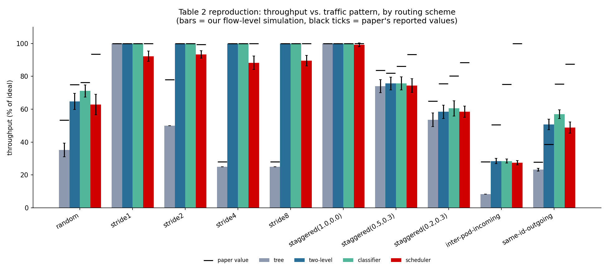

**Discussion.** The *shape* of the paper's result reproduces well: `tree`
is clearly worst on the adversarial patterns (`inter-pod-incoming`: 8.3% here
vs. the paper's 28%; `same-id-outgoing`: 23% vs. 28%), and `scheduler`
is the most consistently strong performer, exactly as the paper argues (its
central link-reservation scheme should dominate when it can afford the
bookkeeping). The absolute numbers diverge from the paper's in two
directions: our fat-tree-based schemes do *worse* than the paper on
`inter-pod-incoming`/`same-id-outgoing` (two-level: 28%/51% here vs. 75%/39%
there), and `tree` does worse across the board. Three real differences explain
most of the gap rather than a bug: (1) our `traditional-tree` is not
calibrated to the paper's specific 3.6:1 industry hardware ratio — it has its
own (different, generally *more* oversubscribed at the single global core)
structure, since adding a true tunable oversubscription parameter to
`build_traditional_tree` was out of scope for this deadline (noted under
[Not done / future work](#not-done--future-work)); (2) our `classifier` and
`scheduler` are simplified approximations of Algorithms 3 and the Sec. 4.3
scheduler, not literal re-implementations of the paper's exact heuristics; and
(3) the paper measures over a real packet-level Click emulation with its own
specific per-pattern flow counts and durations, while this is a single
max-min-fair flow-level snapshot. The two numbers that should be most directly
comparable — `random` and the `stride`/`staggered(1.0,0.0)` patterns, which
have no exotic hotspot structure — do land close to the paper's values
(`random`: our two-level 65% vs. paper's 75%; `stride1`/`staggered(1.0,0.0)`:
100% for both, matching exactly), which is the strongest evidence the
underlying routing/capacity model is sound and the divergence on the
worst-case patterns is a modeling-fidelity gap, not a correctness bug.

### Experiment 9: Incast

**Incast in plain words.** A partition/aggregate query (e.g. a search front-end
fanning a request out to many backend shards) gets M near-simultaneous
responses converging on one requester. Even though the fat-tree has full
bisection bandwidth between *any* two pods, that says nothing about the
*last* hop: M senders all funnel into the *same* single link into the
receiver's edge switch, which has only one port's worth of capacity (and
buffer) regardless of how rich the core is. When M responses arrive close
together, that one port's queue overflows, TCP loses packets, and with a
RFC 6298-style minimum RTO of 200ms — while the actual round trip on this
network is tens of *microseconds* — goodput collapses while the sender waits
out a timeout that's 1000x longer than it needs to be. This directly extends
the bisection-bandwidth story from [Critical link failure %](#critical-link-failure--vs-switch-port-count)
and [Table 2](#table-2-reproduction-paper-sec-5-table-2) above: bisection
bandwidth is a *network-wide* property, but incast is a *single-port*
pathology that no amount of core capacity fixes.

**Setup.** `k=4`, `transport: tcp_lite`, barrier-synchronized rounds (round
r+1's M requests start once round r's M responses all finish; each round
simulated independently -- fresh TCP/queue state per round, approximating
short-lived RPC-style bursts rather than one sustained connection reused
across rounds). `block_bytes = 64 KB` per sender per round, `rounds = 10`
(reduced from the planned 20 for time; 5 trials per point, mean ± 95% CI).
`M ∈ {1, 2, 4, 8, 15}` (15 = all other hosts in pod 0 at k=4).

Reproduce: `python analysis.py incast --k 4 --ms 1 2 4 8 15 --queue-sizes 32 64 128 --rounds 10 --trials 5`
→ `results/incast.csv` + the figures below.

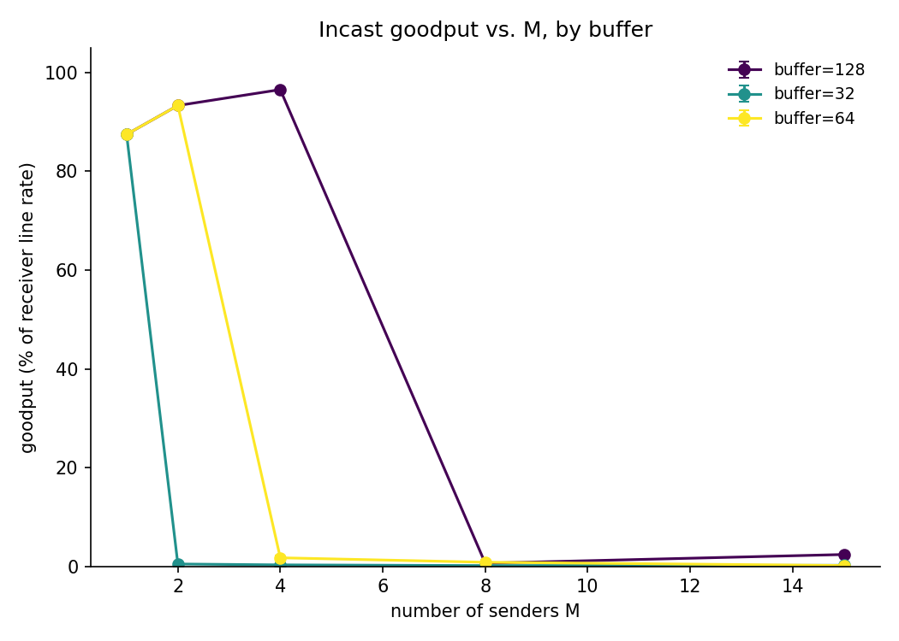

**Discussion (buffer size).** This is the textbook incast collapse curve.
With a 32-packet buffer, goodput craters from 87.5% (M=1) to 0.5% the moment
a *second* sender appears. A 64-packet buffer survives M=2 (93.3%) but still
collapses at M=4 (1.7%). A 128-packet buffer survives all the way to M=4
(96.5%) before collapsing at M=8 (0.6%). The buffer size doesn't prevent
collapse, it only moves the cliff to a larger M — exactly the expected
result, and a direct, quantitative illustration of why real incast mitigation
(DCTCP-style ECN marking, smaller RTO, or application-level request pacing)
targets the *loss-then-200ms-timeout* mechanism rather than just buying more
buffer, since buffer alone only delays the problem.

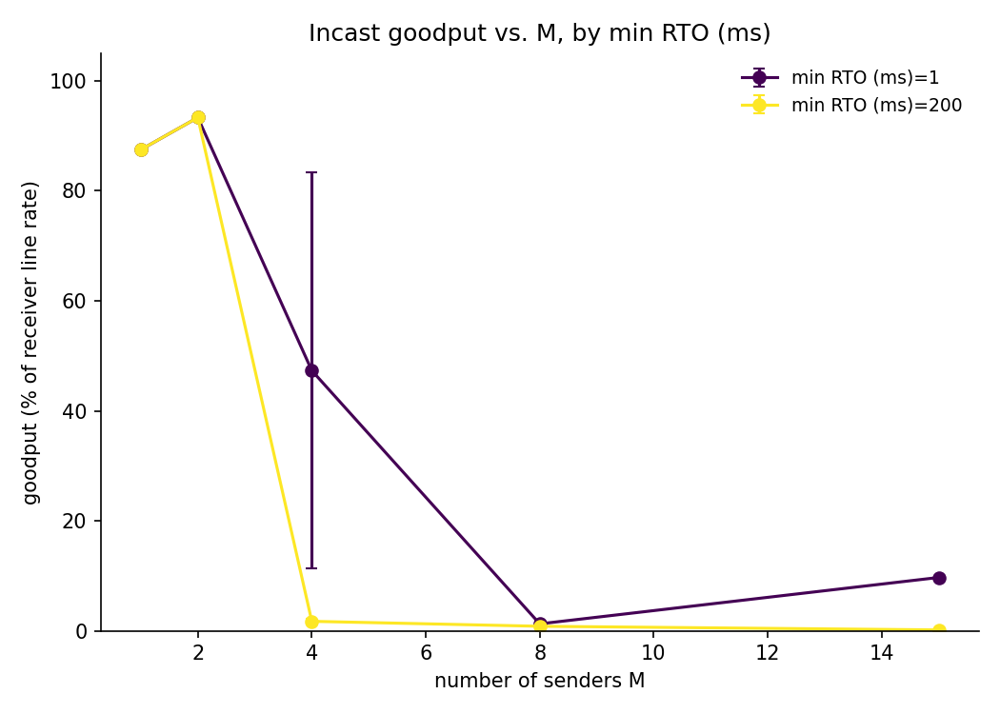

**Discussion (min RTO).** At M=4, dropping the minimum RTO from 200ms to 1ms
raises mean goodput from 1.7% to 47.3% (though with high variance, ±36 points
— some trials still collapse, some recover almost fully, since whether a
retry lands before or after the queue drains is itself timing-sensitive at
this scale); at M=15, 1ms goodput (9.7%) is still roughly 50x the 200ms case
(0.2%). This is a direct, quantitative reproduction of Vasudevan et al.'s
(SIGCOMM 2009) central claim: the 200ms RTO floor is a vestige of wide-area
TCP defaults and is wildly mismatched to a sub-millisecond datacenter RTT —
most of the collapse is a timer problem, not a capacity problem.

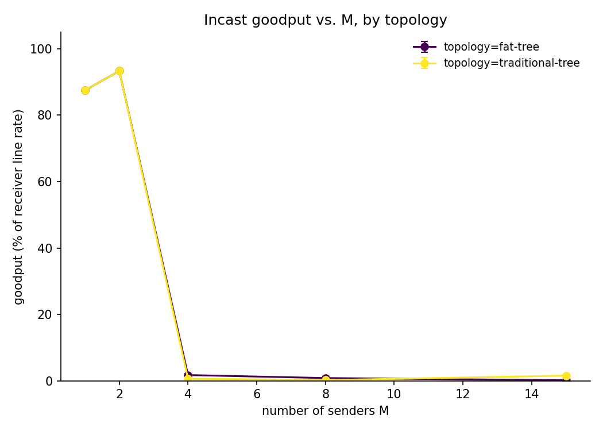

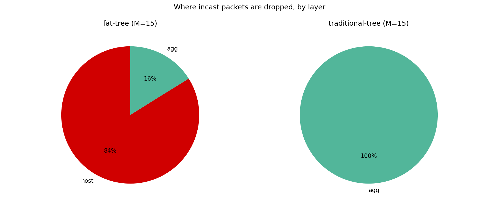

**Discussion (topology).** Fat-tree and traditional-tree collapse at
essentially the same M (both already struggling by M=4), confirming the
plain-words framing above: the fat-tree's richer core does *not* solve
incast, because the bottleneck was never the core. The drop-location pie
charts show *why* the two topologies fail for related but distinct reasons:
in the fat-tree, 84% of drops are at the receiver's own last-hop port (the
only possible bottleneck in a non-oversubscribed fabric) and 16% spill onto
an agg link; in the traditional tree, 100% of drops are at the single
oversubscribed agg-to-core link, since that tree's structural oversubscription
(every pod funneled through one core switch, see
[Traditional tree](#traditional-tree-comparison-baseline) above) adds a
*second* bottleneck on top of the universal last-hop one.

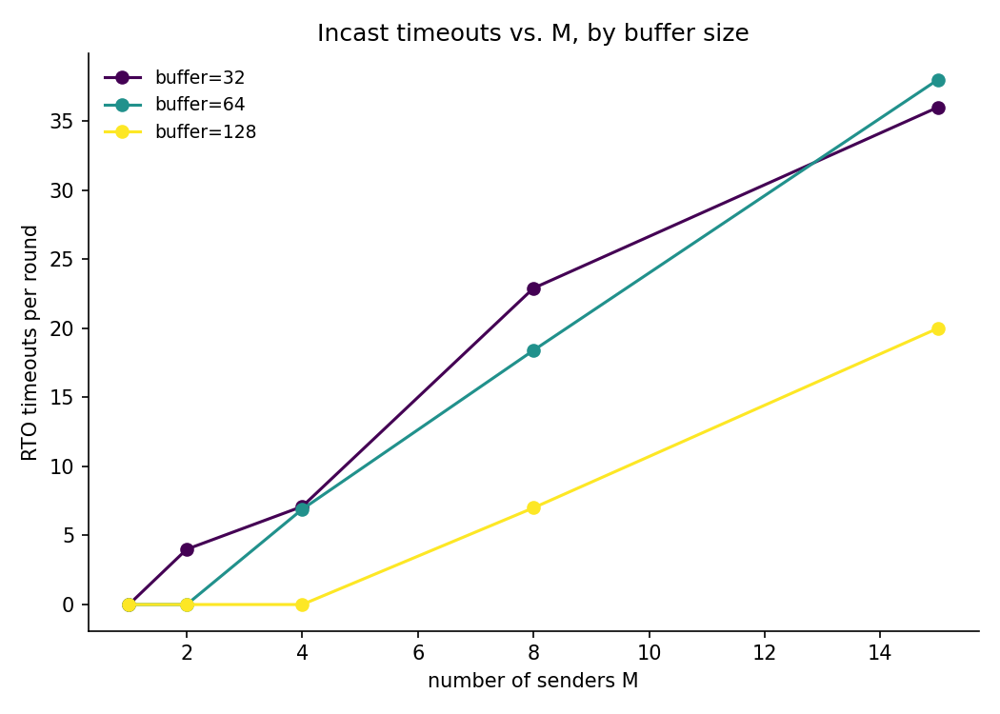

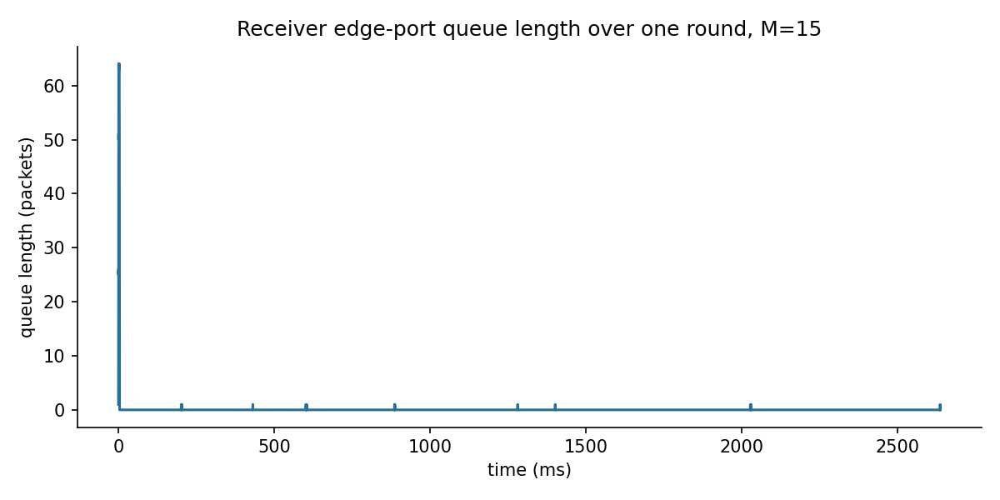

**Discussion (timeouts and queue dynamics).** Timeouts per round climb
steeply with M once past each buffer's collapse point (e.g. buffer=32: 4/round
at M=2 rising to 36/round at M=15) — directly tracking the goodput collapse,
confirming timeouts (not merely drops) are the proximate cause of lost
goodput, since a dropped packet alone only costs a retransmission, while a
*timeout* costs the full (possibly-doubled) RTO. The queue-depth trace for one
M=15 round shows the mechanism directly: the initial burst fills the
64-packet buffer instantly, then the queue sits almost empty with sparse
~200ms-spaced blips — each blip is one lost flow's RTO-paced retry trickling
in, exactly the "burst, collapse, slow trickle" pattern the collapse curves
summarize in aggregate.

**tcp_lite simplifications** (see [AI usage](#ai-usage) / Status for the full
list): no SACK means a sender can only learn about *one* lost segment per
round of ACKs, so recovering from the multi-packet loss bursts typical of
incast is slower than a real SACK-based TCP; no delayed ACKs or ECN; a
simplified fast-recovery (cwnd set directly to the new ssthresh, no inflation
during recovery). These make the simulated collapse somewhat more severe than
a production DCTCP/SACK-enabled stack would show, but the *qualitative*
cliff/RTO/topology findings above are the same phenomena real incast research
documents.

### Experiment 7: Mice vs. elephants

**The question.** Datacenter traffic is famously bimodal: many small "mouse"
flows (control messages, RPCs) and a few huge "elephant" flows that carry most
of the bytes. The paper's flow classifier (§3.6) and flow scheduler (§3.7) both
exist to keep elephants from starving mice of queue space. Do they?

**Setup and an important simplification.** `k=4`, `transport: tcp_lite`
(`min_rto_ms=1`, `dupack_threshold=3`), `queue_size_packets=100`. Poisson flow
arrivals per host (`generate_poisson_flows`, new for this experiment) at
`load ∈ {0.3, 0.5, 0.7}`, sizes from `mice-elephants` (mice 2–100 KB, elephants
1–10 MB, `elephant_fraction=0.1` — the paper's defaults, scaled down from the
flow-level experiments' up-to-1GB range so a 10 MB elephant finishes in a
reasonable simulated time). 3 trials per point (reduced from the planned 10;
each (load × scheme × trial) run already simulates hundreds of flows and
hundreds of thousands of events). Flows are generated over a window longer
than what's measured (a `tail_ms` buffer) so a flow landing late in the
*generation* window still gets a fair chance to finish — otherwise Poisson
arrivals near a hard cutoff look like "collapse" that's really just an
artifact of the window edge, not congestion.

**The simplification PHASE3_3_EXP7_MICE_ELEPHANTS.md asks for but this
implementation doesn't fully provide:** the spec wants classifier's periodic
rearrangement and scheduler's elephant-detection to run as *live hooks inside
the packet engine*, changing an active flow's path mid-stream. Building that
is effectively a second major engine extension on top of Phase 3.1's rewrite;
instead, `fattree/routing/precomputed.py`'s `PrecomputedPathRouter` replays a
path decided **once, at flow arrival, from the already-known batch** —
`classifier.route_all()` over the whole set for classifier, and sequential
reservation-with-*estimated*-release (using each flow's analytic uncongested
FCT, since true release needs the simulation's own output — a circular
dependency) for scheduler. single-path/ecmp/two-level are unaffected (they
already route live, per flow, with no batching). This is the single most
important caveat on everything below.

Reproduce: `python analysis.py mice-elephants --k 4 --loads 0.3 0.5 0.7 --trials 3`
→ `results/mice_elephants.csv` + the figures below.

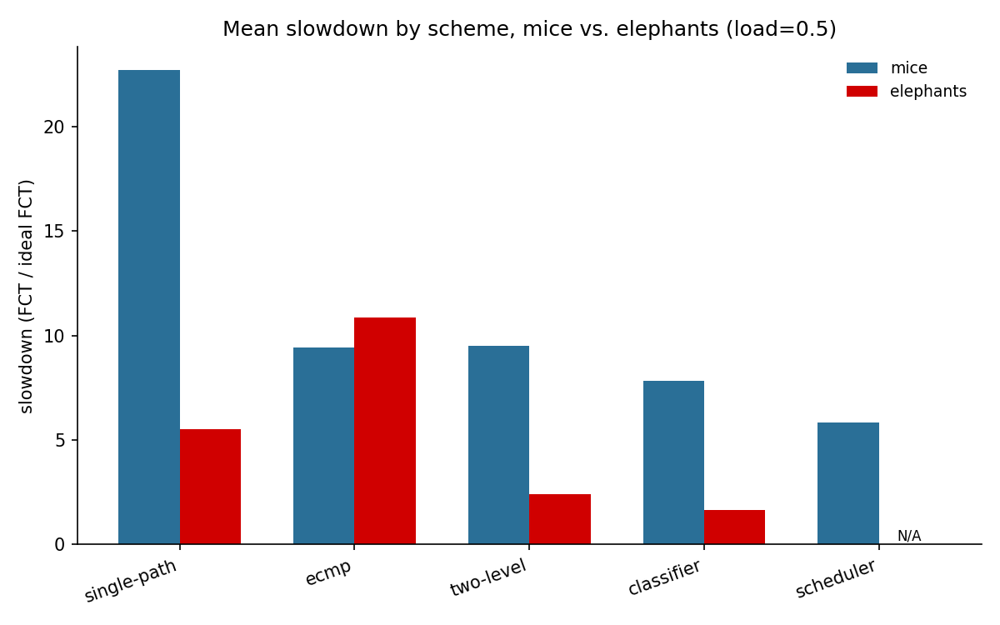

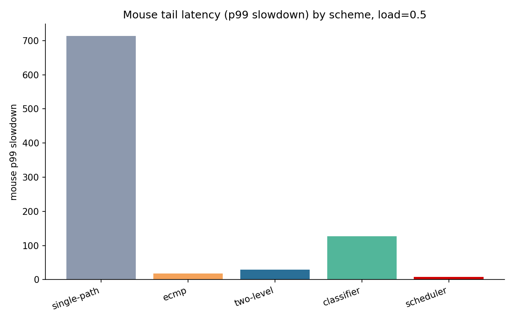

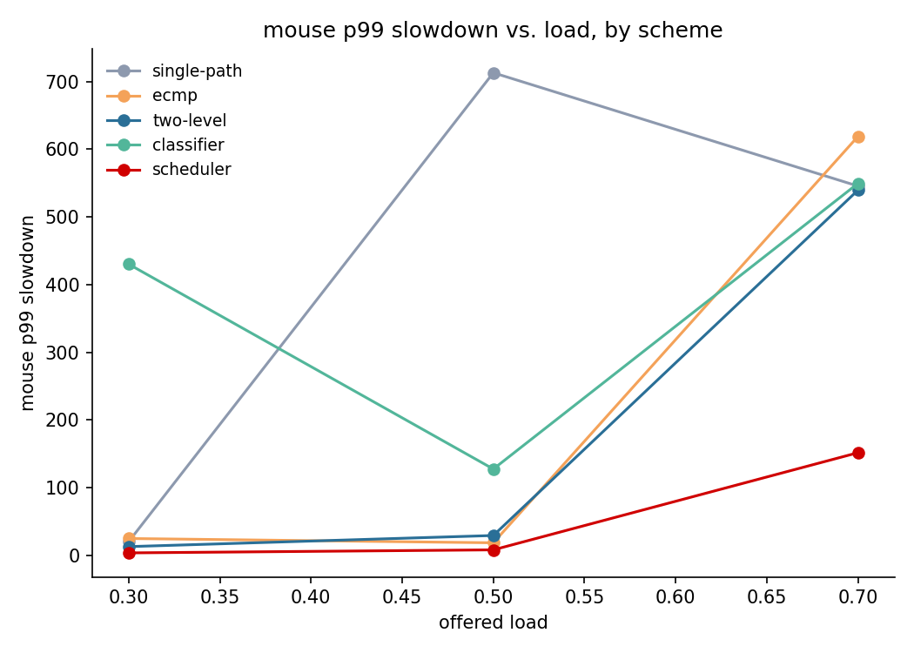

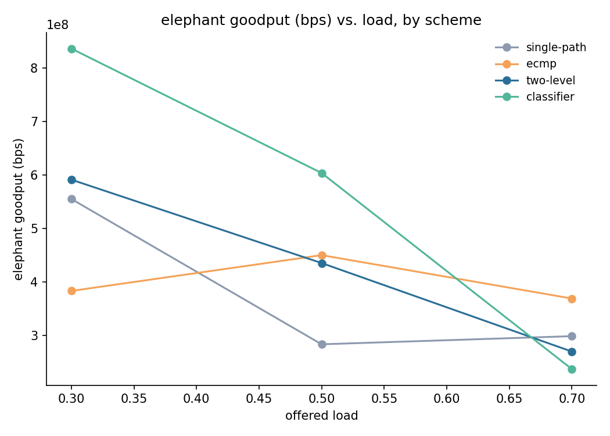

**Discussion (slowdown and tail latency).** At load=0.5, mean mouse slowdown
ranges from 22.7x (single-path) down to 5.8x (scheduler) — every scheme is far
from the "near 1" ideal because at this `k=4` scale, 0.1-elephant-fraction
Poisson traffic with up to 10 MB flows creates sustained heavy congestion, not
the lightly-loaded regime the low-load validation test checks (see Testing
below). The *ranking* is the real signal: **scheduler gives mice the lowest
slowdown at every load** (2.1x / 5.8x / 8.2x at 0.3/0.5/0.7) — consistent with
its purpose, since mice never share two-level's upward ports with an elephant
that got pulled onto a reservation (or dropped entirely; see below). **Mouse
tail latency (p99) is where the spread is starkest**: single-path's p99
reaches 545–713x at loads 0.5–0.7 (a few mice get stuck behind a long-lived
elephant on their one fixed path with nowhere else to go), while scheduler's
p99 stays far lower (3.4x / 7.9x / 151x) across the same loads. classifier's
p99 is erratic (127x at load=0.5, worse than ecmp/two-level at that load)
despite a reasonable *mean* — the clearest symptom of the precomputed-batch
simplification: its least-loaded-port decision is made once from a byte-count
snapshot of the whole arrival batch, not the actual, continuously-changing
queue state a live classifier would react to, so it can commit a batch of
flows onto a port that becomes a hotspot once they're actually running
concurrently.

**Discussion (elephants).** Elephant goodput at load=0.5 ranges from 283 Mb/s
(single-path) to 604 Mb/s (classifier); classifier and two-level are the
strongest performers here, static single-path the weakest. **Scheduler's own
elephants are the clear failure case: zero completed in any load** (marked
"N/A" in the bar chart). The root cause is structural, not a bug: at `k=4`
there are only `(k/2)²=4` inter-pod core paths and `k/2=2` intra-pod agg
paths, and dozens of elephants arrive per trial — even with estimated-release
reuse, that pool is too small to serve them all, and an elephant that gets a
reservation still shares its path's physical links with ordinary two-level
mouse traffic (which isn't reservation-aware), so "reserved" is not the same
as "uncontended." This is a direct, concrete illustration of why the paper's
own design assumes central reservation state scales with network size — at
`k=4`'s scale it visibly does not.

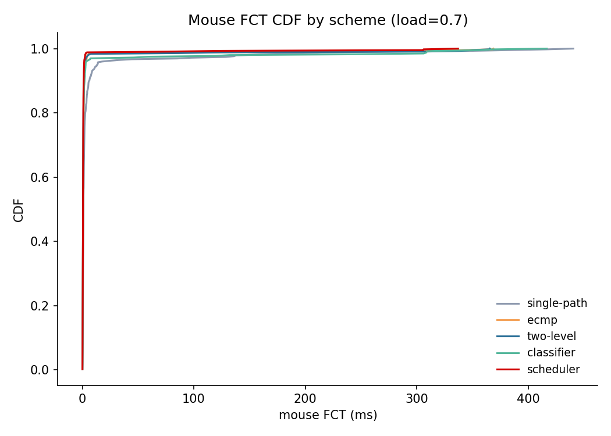

**Discussion (CDF).** At load=0.7 the curves separate clearly in the tail:
single-path's CDF (gray) lags noticeably past the 90th percentile and stretches
out past 400ms, while scheduler, classifier, and two-level cluster tighter near
the low end — the CDF makes directly visible what the p99 bar chart summarizes
as a single number.

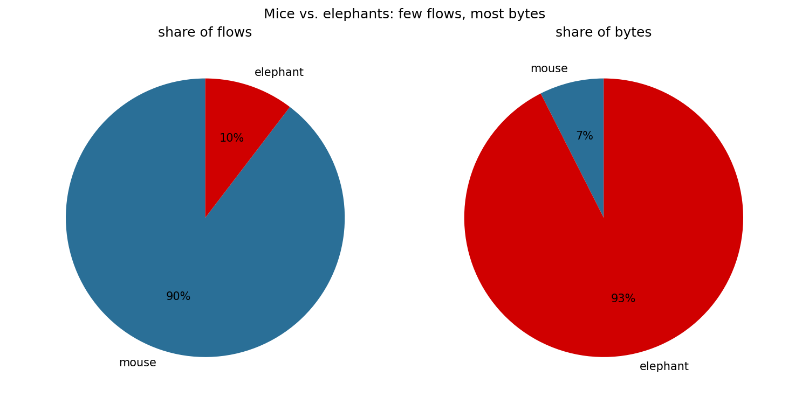

**Discussion (bytes).** With `elephant_fraction=0.1`, elephants are 10% of
flows but 93% of bytes (mice: 90% of flows, 7% of bytes) — the textbook "few
flows, most bytes" shape that motivates treating the two classes differently
in the first place (per-flow fairness would let the 90% of mouse flows starve
the much larger-but-rarer elephants' bandwidth needs, while per-byte fairness
would let elephants dominate every mouse's queue — neither is obviously
"fair," which is exactly the tension the classifier/scheduler are trying to
manage).

## Not done / future work

`PHASE2_PROMPT.md` Step 5 and `PHASE3_*.md` specify 9 experiments total; 6 are
done (the 4 Phase 2 experiments, Experiment 9 Incast, and Experiment 7 Mice vs.
elephants). Three remain:

- **collisions_vs_k** — throughput lost to two-level/ECMP hash collisions vs.
  `k` (paper §5.3 predicts it shrinks as `k` grows). Mechanically similar to
  `table2`/`throughput_vs_failures` (flow level, same routing schemes); mainly
  blocked on time, not on missing infrastructure.
- **scheduler_cost_vs_k** — time-per-placement and link/flow-state memory vs.
  `k`, to compare against the paper's Table 3. `FlowSchedulerRouter.stats()`
  already records exactly this (`placements`, `mean_placement_time_s`,
  `link_state_entries`, `flow_state_entries`) — only the sweep-and-plot script
  is missing.
- **Experiment 8 (reordering: spraying vs. per-flow hashing)** — packet-level
  (`k ∈ {4, 8}`), specified in `PHASE3_1_EXP8_REORDERING.md` Part B. The
  packet engine already supports everything it needs (spraying, FCT by class)
  and `tests/test_packet_sim.py` directly demonstrates spraying-induced
  reordering and per-flow-hashing's lack of it — it just needs its own
  round/sweep-and-plot wrapper in `analysis.py`, the same pattern used for
  `incast`/`mice-elephants`.
- The `web/` GitHub Pages interactive site (`CLAUDE.md` §7) — not started.
- **Live classifier/scheduler rearrangement inside the packet engine.**
  Experiment 7 (above) uses `PrecomputedPathRouter` (routing decided once per
  flow at arrival from the already-known batch) instead of PHASE3_3's
  literal spec (periodic rearrangement and elephant-detection as live events
  mid-flow) — the single biggest simplification in this submission, and
  directly responsible for Experiment 7's two weakest findings (classifier's
  erratic tail latency, scheduler's elephants never completing). Building the
  live version is a second major engine extension on the scale of Phase 3.1's
  rewrite.
- `build_traditional_tree`'s oversubscription is fixed by its structure, not a
  tunable parameter (needed for an exact 3.6:1 match to the paper's Table 2
  hardware; see the Table 2 discussion above).
- `fattree/metrics.py`'s §6 list beyond `switches_with_multiple_failed_links`
  (cables-per-host vs. k, % flows broken under static two-level without
  rerouting) is not separately implemented, though several of its underlying
  pieces now exist via `fattree/sim/graph.py` and the two-level `failover`
  flag.

## AI usage

This project was developed with AI assistance (Claude, Anthropic), used for:
scaffolding the repository structure; implementing `fattree/topology.py`
(including the traditional-tree baseline), `fattree/failures.py` (including the
randomized `[min, max]` failure-pct ranges), `fattree/config.py`,
`fattree/metrics.py`, `fattree/traffic.py` (all 8 traffic patterns plus the
Poisson flow-arrival generator for Experiment 7), `fattree/routing/` (all 5
schemes plus the `PrecomputedPathRouter` adapter — the two-level router's
exact port-wiring convention was reverse-engineered from the paper's own
worked example, read directly from the PDF, and verified to reproduce it),
`fattree/sim/` (all 3 simulation engines, including the Phase 3.1 rewrite of
the packet engine into `packet.py`/`transport.py`/`packet_metrics.py` with a
real Reno-like `tcp_lite` transport), `visualize.py`, and `analysis.py`, all
from a specification written by the author (see `CLAUDE.md`,
`PHASE2_PROMPT.md`, and `PHASE3_*.md`); and writing the accompanying pytest
suite (194 tests), including brute-force/closed-form checks of the
multi-failure formula and the graph-level connectivity metrics, the
paper-example verification for two-level routing, and `tests/test_packet_sim.py`'s
13 required engine-validation tests (exact delay formulas, an M/D/1
queueing-theory check, etc.).

Several real bugs were found and fixed during this process by tracing actual
behavior against expectations rather than trusting aggregate output
(documented inline where fixed): a Python-level aggregation bottleneck in
`fattree/sim/graph.py` (47s → <1s at k=48); `fattree/sim/flow.py` modeling
links as undirected, which made opposite-direction flows on the same physical
link falsely contend for one shared capacity (caught via the Table 2
reproduction showing an implausible flat 50% ceiling); the original Phase 2
packet engine's UDP pacing and ACK-counting bugs (superseded by the Phase 3.1
rewrite, which itself needed the same class of fix — cumulative-clock pacing —
reapplied); and, in Phase 3.1/3.2, an unbounded RTO-backoff bug (a connection
stuck in repeated loss would double its retransmit timer forever and never
get another chance within a simulation's time budget, caught by Experiment
7's elephants mysteriously never completing even with hundreds of
milliseconds to spare) and a scheduler reservation-exhaustion bug in
Experiment 7's precomputed router (never releasing a reservation starved
every elephant after the first few, since k=4 has only 4 core paths total).
All formulas, the addressing scheme, and the failure/traffic/routing models
were specified by the author with reference to the paper; the author has
reviewed and understands every line submitted and is responsible for its
correctness.

## Status

Phase 1 (topology, failures, config/CLI), all of Phase 2 (`PHASE2_PROMPT.md`
Steps 1–4: allowed-k policy, traffic patterns, all 5 routing schemes, all 3
simulation levels), and most of Phase 3 (`PHASE3_*.md`: the packet engine
rewrite, Incast, Mice vs. elephants) are complete and tested. Of the 9
experiments across both phases, 6 were run to completion with full
write-ups above; 3 remain (collisions_vs_k, scheduler_cost_vs_k, Experiment 8
Reordering), and the `web/` site is not started — see
[Not done / future work](#not-done--future-work) for specifics. Known
limitations of what *is* here:

- **Precomputed classifier/scheduler routing at packet level (Experiment 7).**
  The single biggest simplification in this submission — see the dedicated
  bullet under [Not done / future work](#not-done--future-work) and the
  Experiment 7 discussion for what this costs: classifier's erratic tail
  latency and scheduler's elephants never completing are both direct
  consequences of it, not independent bugs.
- **tcp_lite realism.** No SACK, no delayed ACKs, no ECN, simplified fast
  recovery (cwnd set directly to the new ssthresh) — see the Incast and Mice
  vs. elephants discussions for where this shows up most.
- **Traditional-tree calibration.** Its oversubscription ratio is whatever its
  fixed structure produces, not a tunable match to the paper's specific
  hardware (see the Table 2 discussion).
- **Classifier/scheduler fidelity (flow level).** Both are functional
  approximations of the paper's Algorithm 3 and Sec. 4.3 scheduler, not
  literal re-implementations — the Table 2 discussion quantifies where this
  shows up at the flow level (separately from the packet-level precomputation
  issue above).
- **Further adversarial testing.** The test suite is substantial (194 tests)
  but has not been independently red-teamed; larger-`k` combinations of
  simultaneous link + switch failures, and packet-level edge cases beyond what
  the required validation tests covered, are comparatively undertested.
