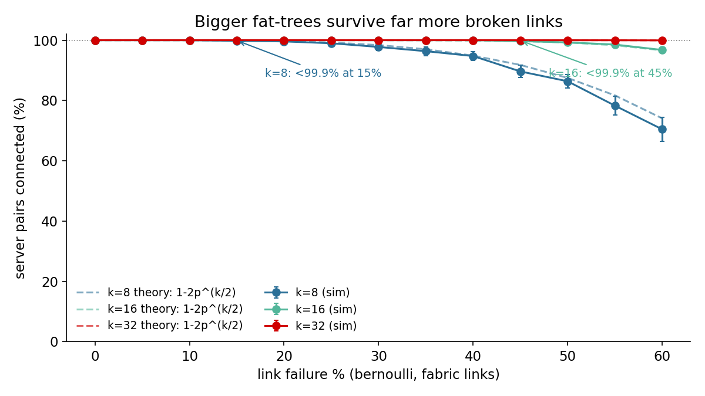
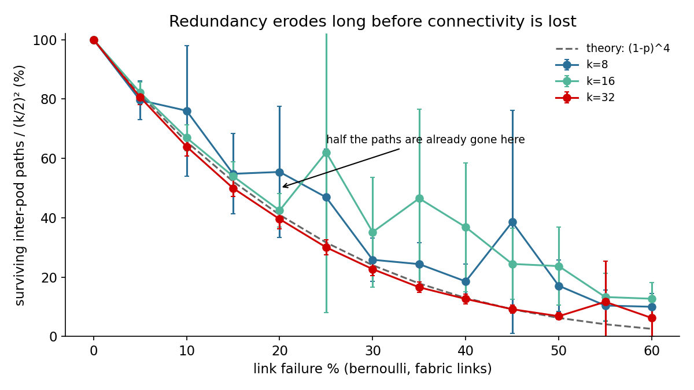
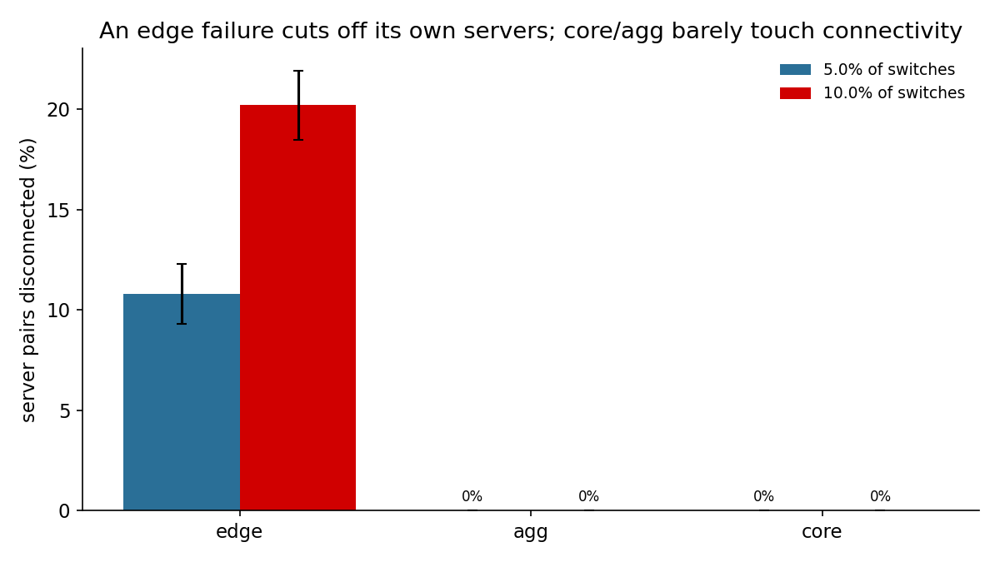
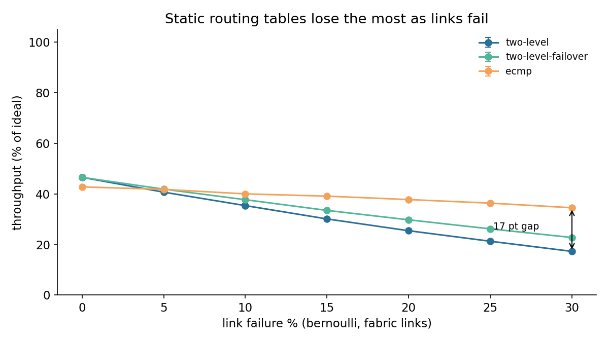
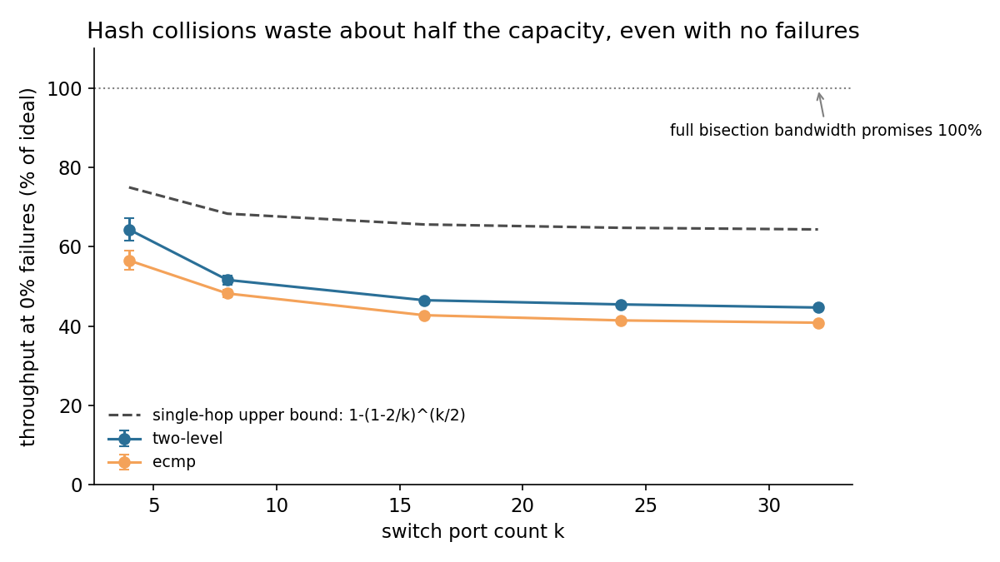
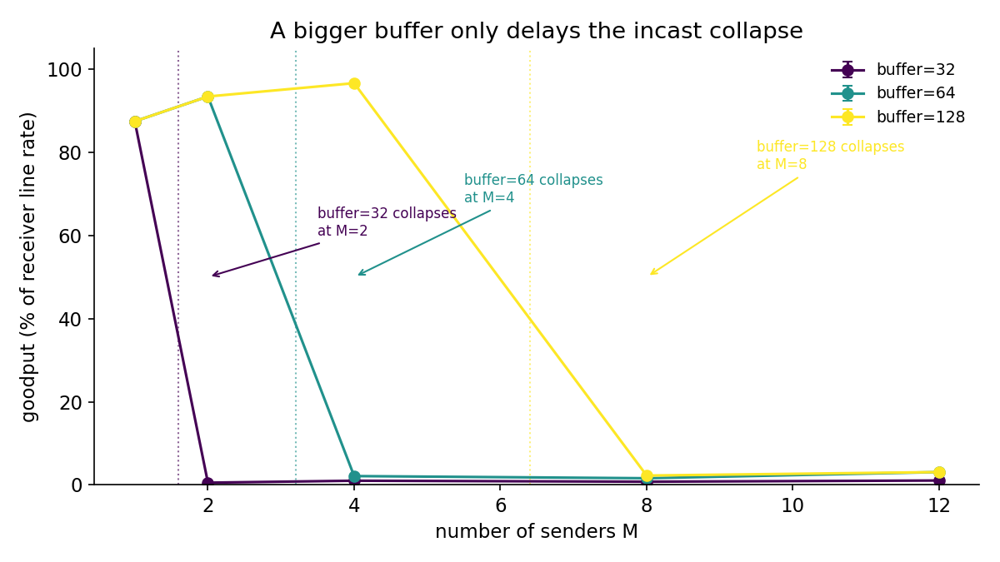
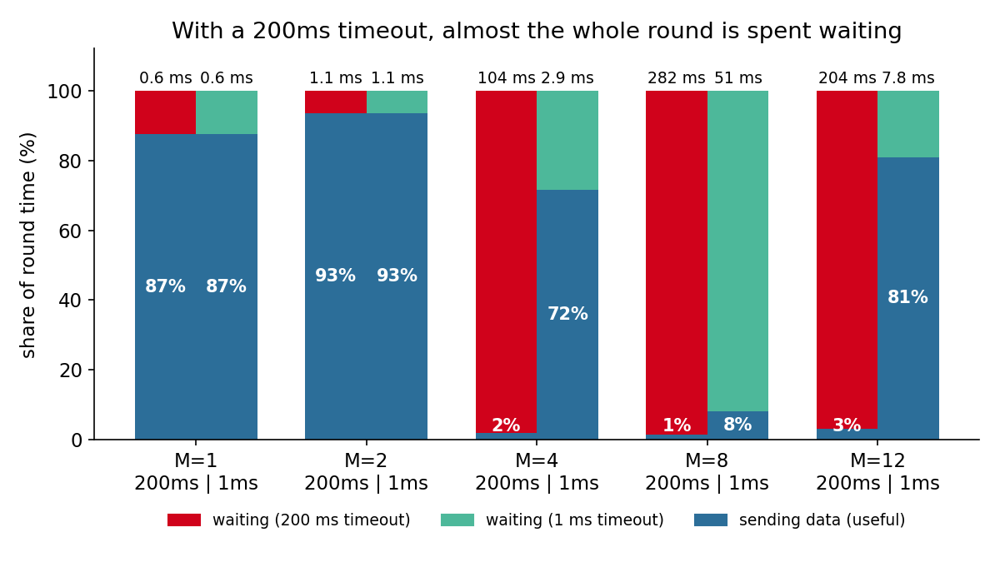
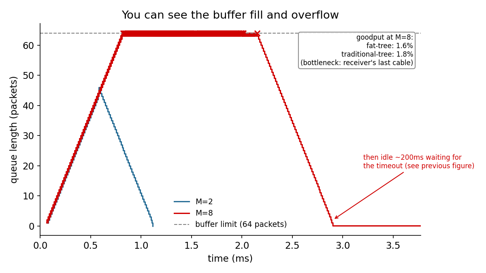

# Fat-Tree Network Topology

Homework 1, course 361.2.2460 — Data Center & AI Networking (BGU, semester A 2026/27).

Three things stood out. **(1) Bigger networks survive failures far better:** with 60% of
links down, a `k=32` network is still 99.95% connected, while a `k=8` network drops below
99.9% connected at just 15%. **(2) Even with zero failures, hash-based routing wastes
about half the network's promised bandwidth:** `two-level` routing only reaches 44.7% of
ideal at `k=32`, not the ~65% a simple estimate predicts — the opposite of what the paper
itself expected. **(3) Incast collapses sharply once too many servers answer at once, and
it's mostly a timer problem:** at 8 senders, cutting the retry timeout from 200ms to 1ms
recovers most of the lost speed — though a rare retry pathology can still stall a few
rounds badly even then.

> M. Al-Fares, A. Loukissas, A. Vahdat, "A Scalable, Commodity Data Center Network
> Architecture," SIGCOMM Comput. Commun. Rev., vol. 38, no. 4, pp. 63–74, Oct. 2008,
> doi:[10.1145/1402946.1402967](https://doi.org/10.1145/1402946.1402967).

## The topology

A `k`-ary fat-tree (paper Sec. 3): `k` pods, each with `k/2` edge and `k/2` aggregation
switches (complete bipartite within the pod), `(k/2)²` core switches each wired to every
pod via one specific "row." Built in `fattree/topology.py` on top of
[networkx](https://networkx.org/) — switches/hosts are graph nodes, links are edges,
failures are node/edge removal — with the paper's own IP addressing scheme (Sec. 3.2),
verified against its Fig. 3 worked example. `topology.type` also accepts
`traditional-tree`: one agg switch per pod and a single global core switch (same host
count, zero redundancy above the edge layer), used as the non-fat-tree comparison in
[Experiment 3](#experiment-3-incast).

| | formula | k=4 | k=8 | k=16 |
|---|---|---|---|---|
| hosts | k³/4 | 16 | 128 | 1024 |
| switches | 5k²/4 | 20 | 80 | 320 |
| links per layer | k³/4 | 16 | 128 | 1024 |
| core switches | (k/2)² | 4 | 16 | 64 |
| bisection width | k³/8 | 8 | 64 | 512 |
| hop count | 2 / 4 / 6 | same-edge / same-pod / cross-pod |

`k=4`, no failures (matches the paper's Fig. 3):


`k=8` traditional tree, 5% link failures — one failed edge-agg link isolates an entire
edge switch's hosts (no redundant path exists, unlike the fat-tree):


```bash
python visualize.py --k 8 --link-pct 5 --seed 1 --out figures/topology_k8.png
python visualize.py --k 8 --topology-type traditional-tree --link-pct 5 --seed 1 \
    --out figures/topology_traditional_k8.png
```

## Install & run

```bash
python3 -m venv .venv && source .venv/bin/activate
pip install -r requirements.txt
python -m pytest tests/ -v          # 209 tests

# Experiment 1: Resilience -- what breaks, and how much it matters
python analysis.py e1-resilience --ks 8 16 32 \
    --pcts 0 5 10 15 20 25 30 35 40 45 50 55 60 --trials 30 \
    --layer-k 16 --switch-pcts 5 10

# Experiment 2: Speed under failures, and the hash-collision ceiling
python analysis.py e2-throughput --k 16 --pcts 0 5 10 15 20 25 30 \
    --ks 4 8 16 24 32 --trials 20

# Experiment 3: Incast
python analysis.py e3-incast --ms 1 2 4 8 12 --queue-sizes 32 64 128 \
    --time-buffer 64 --compare-m 8 --rounds 20 --trials 10

# or, all of the above in one command:
./run_all.sh
```

`run_all.sh` runs the tests and all three experiments and took **~20.5 minutes** on a
laptop (the `k=32`, 20-trial ECMP points in Experiment 2 dominate that time — see
[Limitations](#limitations)). Results are deterministic for the seeds used throughout
(rerunning reproduces every number in this README exactly; verified above — a rerun's
`results/e1_layer.csv` came back byte-identical). Each experiment writes
`results/eN_*.csv` + `figures/eN_*.png`. See
[Other analyses available in the code](#other-analyses-available-in-the-code) for
additional subcommands not part of this submission's presented results.

## Input parameters

Set via `config/default.yaml` (or `config/experiments/e{1,2,3}_*.yaml`, which document
each experiment's fixed parameters), overridable on the command line.

| Parameter | Config path | CLI flag | Default | Meaning |
|---|---|---|---|---|
| Switch port count | `topology.k` | `--k` | 8 | Must be in `allowed_k`. Determines `k³/4` hosts, `5k²/4` switches, `k³/4` links/layer. |
| Allowed port counts | `allowed_k` | — | `[4,8,16,24,32,48,64]` | Real switch port counts; `k` and any `sweep.values` must come from this list. |
| Topology type | `topology.type` | `--topology-type` | `fat-tree` | `fat-tree \| traditional-tree`. |
| Link failure % | `failures.link_pct` | `--link-pct` / `--link-pct-range MIN MAX` | 1 | Fixed %, or `[min,max]` range drawn per seeded run. |
| Switch failure % | `failures.switch_pct` | `--switch-pct` / `--switch-pct-range MIN MAX` | 0 | Same, for switches (removes incident links too). |
| Failure mode | `failures.mode` | `--mode` | `exact` | `exact` = `round(pct·N)` chosen without replacement; `bernoulli` = independent per-element probability `p`. |
| Traffic pattern | `traffic.pattern` | `--pattern` | `random` | 8 patterns (Sec. 5.2) — see `fattree/traffic.py`. |
| Offered load | `traffic.load` | `--load` | 1.0 | Each host sends at `load × link rate`. |
| Routing scheme | `routing` | `--routing` | `two-level` | `single-path \| ecmp \| two-level \| classifier \| scheduler`. |
| Simulation level | `simulation.level` | — | `flow` | `graph \| flow \| packet` (packet only `k ≤ 8`) — see below. |
| Random seed | `seed` | `--seed` | 1 | Trial `t` uses `seed + t`. |
| Trials per point | `trials` | `--trials` | 30 | Repetitions for sweeps. |

Config/CLI are validated with explicit errors (`fattree/config.py`). The full schema
(`incast.*`, `packet.*`, `classifier.*`, ...) is documented inline in
`config/default.yaml` and `config/experiments/*.yaml`.

## Simulation levels

`simulation.level` trades fidelity for speed — a full packet simulation at `k=48`
(27,648 hosts) isn't tractable with a Python discrete-event loop, so each experiment
uses the cheapest level that still answers its question:

- **graph** (`fattree/sim/graph.py`) — structure only, no traffic/routing; `k=48` in
  under a second via an edge-switch aggregation trick. **Used by Experiment 1**, which
  only asks "are these two hosts still connected," not "how fast."
- **flow** (`fattree/sim/flow.py`) — routes every flow, then computes max-min fair rates
  (progressive filling) over link capacities; no queueing. **Used by Experiment 2**,
  which needs real contention/sharing behavior at `k` up to 32 — intractable at the
  packet level, but flow level answers "how much throughput" exactly.
- **packet** (`fattree/sim/packet.py`) — genuine discrete-event simulation,
  integer-nanosecond clock, FIFO drop-tail queues, `tcp_lite` (Reno-like, RFC 6298 RTO,
  RFC 5681 go-back-N recovery), restricted to `k ≤ 8`. **Used by Experiment 3**, which is
  specifically about queueing, drops, and timeouts — none of which graph or flow level
  can represent at all.

## Results

Each figure below follows the same four-part explanation: **how to read it** (axes,
colors), **what it shows** (the key numbers), **why** (the mechanism, in plain words),
**so what** (why it matters). `k` = switch port count, the one parameter that sets the
whole network's size (see [The topology](#the-topology)).

### Experiment 1: Resilience — what breaks, and how much it matters

**Question.** When random parts of the network fail, when do servers lose contact with
each other, and does it matter *which layer* fails?

**Setup.** Part A: `k ∈ {8,16,32}`, link failure % ∈ `{0,5,...,60}` (bernoulli, fabric
links only), 30 trials/point. Part B: `k=16` fixed, 5%/10% switch failure in *one* layer
at a time (edge-only / agg-only / core-only), 30 trials.

```bash
python analysis.py e1-resilience --ks 8 16 32 --pcts 0 5 ... 60 --trials 30
```



**How to read it.** X-axis: % of fabric links (the edge↔aggregation and
aggregation↔core cables) that fail, picked independently at random. Y-axis: % of server
pairs that can still reach each other. One solid line per `k`; the dashed line is the
theory formula for that `k`.

**What it shows.**
| `k` | drops below 99.9% connected at |
|---|---|
| 8 | 15% link failure |
| 16 | 45% link failure |
| 32 | never, in the tested range (still 99.95% at 60%) |

**Why.** A server loses contact only once *every one* of its edge switch's `k/2` uplinks
has failed. Formula: `1 - 2p^(k/2)`, where `p` is the failure probability of one link.
More uplinks means that "all fail together" event gets rarer very fast as `k` grows —
each doubling of `k` buys much more than double the safety margin.

**So what.** Picking a bigger switch (higher `k`) buys a data center far more real-world
fault tolerance, not just more hosts — a concrete reason to prefer higher-radix hardware
even before counting the extra capacity.



**How to read it.** Same x-axis. Y-axis: **path diversity**, the % of the `(k/2)²`
separate routes between two pods that still exist — like counting how many different
roads still connect two cities. Dashed line is the theory formula.

**What it shows.** At the exact point where theory says half the routes are gone
(`(1-p)⁴ = 0.5`, i.e. ~15.9% link failure), measured diversity for `k=8/16/32` is
already down to ~50% too, within its 95% CI — and every `k` value in the previous figure
is still above 99.9% connected at that same point.

**Why.** A route survives only if *all 4* of its links survive: `(1-p)⁴`. The simulation
counts only the original 4-hop routes, averaged over every pair of edge switches (not
just one pair, which was too small a sample and gave a noisy, zigzagging result in
earlier versions of this figure). A longer detour through a neighboring switch can exist
once the direct routes are gone, but it isn't one of the original `(k/2)²` routes, so it
isn't counted here.

**So what.** Backup routes disappear much faster than the network actually stops
working — "still 100% connected" can mean "down to its very last route," which Experiment
2 shows has a real performance cost.



**How to read it.** Bars: % of server pairs that lose contact when 5% or 10% of the
switches in *one* layer fail, at `k=16`. Three groups: edge, aggregation, core.

**What it shows.**
| failed layer | 5% of switches | 10% of switches |
|---|---|---|
| edge | 10.8% disconnected | 20.2% disconnected |
| aggregation | 0% | 0% |
| core | 0% | 0% |

**Why.** Each edge switch is the *only* connection for the servers plugged directly into
it, so losing one directly orphans its own servers. Aggregation and core switches each
have several redundant siblings the network can instantly route around instead.

**So what.** Which layer fails matters far more than how many switches fail — an alert
that only tracks "% of switches down," without saying which layer, hides the one failure
type that actually costs connectivity. (This experiment only measures connectivity, not
speed — a fully-connected network can still be slow, which is what Experiment 2 covers.)

### Experiment 2: Speed under failures, and the hash-collision ceiling

**Question.** How much of full line-rate speed do servers actually get, with and
without failures, and how much does the routing scheme change that?

**Setup.** Flow level (every flow gets a fair share of whatever capacity it can reach,
computed directly, not packet-by-packet), random traffic, every host sending at line
rate. Three schemes: `two-level` (the paper's own static routing tables), `two-level`
with `failover` (retries another port instead of giving up), and **ECMP** (Equal-Cost
Multi-Path: spreads flows across several equally-good live routes, recomputed on the
fly). Part A: `k=16`, link failure % ∈ `{0,5,...,30}`, 20 trials. Part B: 0% failures,
`k ∈ {4,8,16,24,32}`, 20 trials.

```bash
python analysis.py e2-throughput --k 16 --pcts 0 5 ... 30 --ks 4 8 16 24 32 --trials 20
```



**How to read it.** X-axis: link failure %. Y-axis: throughput as a % of ideal (what
every server would get if nothing ever contended for the same link). One line per
scheme, `k=16`.

**What it shows.**
| scheme | 0% failure | 30% failure |
|---|---|---|
| `two-level` | 46.5% | 17.3% |
| `two-level` + `failover` | 46.5% | 22.8% |
| ECMP | 42.8% | 34.5% |

**Why.** `two-level`'s routing tables are fixed in advance: if a flow's assigned route
crosses a failed link, the flow is simply dropped, not rerouted. ECMP recomputes live on
every call, so it reroutes around a failure automatically whenever another equally-short
route still exists. `failover` is a small patch to `two-level`: retry one other port
before giving up.

**So what.** A routing scheme that looks fine with no failures can lose most of its
throughput under real-world conditions — failure tolerance has to be designed into the
routing choice itself, not assumed to come for free.



**How to read it.** X-axis: `k`. Y-axis: throughput at 0% failures. Dotted line: the
100% a fat-tree's design promises (its **bisection bandwidth** — the total capacity
available between any two halves of the network). Dashed line: a simple estimate for one
random routing decision. (`two-level` with `failover` is left off this plot — at 0%
failures it's numerically identical to plain `two-level`, so its line exactly hid the
other one; the number is still in `results/e2_collision_ceiling.csv`.)

**What it shows.**
| `k` | `two-level` | ECMP | single-hop estimate |
|---|---|---|---|
| 4 | 64.4% | 56.6% | 75.0% |
| 32 | 44.7% | 40.9% | 64.4% |

**Why.** A **hash collision** is two flows, each picked by an independent coin flip,
landing on the same output port and having to share it — like two cars from different
on-ramps merging into one lane. Real routing makes this coin flip at *two* separate hops
(edge→aggregation, then aggregation→core), not the one hop the dashed estimate models,
so collisions compound — and that gap gets *wider*, not narrower, as `k` grows. The
paper expected the opposite, in its own words: *"We expect the performance for the
two-level table to improve for random communication with increasing `k` as there will be
less likelihood of multiple flows colliding on a single link with higher `k`."* The
measurement shows `two-level` actually getting worse with `k` (64.4% → 44.7%), not
better. An independent re-implementation (`tests/test_e2_throughput.py`, sharing no code
with the main routing/flow modules) reproduces the same ~47% at `k=8`, confirming this
isn't a pipeline bug.

**So what.** Even a perfectly healthy fat-tree doesn't deliver its promised bandwidth
under ordinary random traffic. This real gap is exactly what motivated the same authors'
follow-up paper, Hedera (NSDI 2010), to add a central scheduler that actively avoids
collisions instead of hoping random hashing avoids them.

### Experiment 3: Incast

**Question.** When many servers answer one server at nearly the same moment (an
**incast** — e.g. a search query fanning out to many backends, all replying together),
why does throughput collapse, what controls the collapse point, and does the fat-tree's
extra core capacity help at all?

**Setup.** Packet level (the only level that models queues, drops, and timeouts), `k=4`,
`tcp_lite` transport (see [Limitations](#limitations)), `M ∈ {1,2,4,8,12}` senders (12 =
every host outside the receiver's pod at `k=4`; higher values raise an error rather than
silently using fewer senders, see `fattree/traffic.py`), 64 KB block per sender per
round, 20 barrier-synchronized rounds, 10 trials, receiver **buffer** (queue) size ∈
`{32,64,128}` packets, minimum retry **timeout (RTO)** ∈ `{200ms, 1ms}`.

```bash
python analysis.py e3-incast --ms 1 2 4 8 12 --queue-sizes 32 64 128 \
    --time-buffer 64 --compare-m 8 --rounds 20 --trials 10
```



**How to read it.** X-axis: number of senders `M` answering at once. Y-axis:
**goodput** — the % of the receiver's own cable capacity actually delivered as useful
data. One line per receiver buffer size.

**What it shows.**
| buffer | collapses once `M` reaches |
|---|---|
| 32 packets | 2 |
| 64 packets | 4 |
| 128 packets | 8 |

**Why.** A sender's window starts small and doubles each round trip; after the first
round trip it's `2 × init_cwnd` (20 packets here). Once that many senders' data arrives
together, the buffer — sized to hold only so many packets — overflows, packets are lost,
and TCP must wait out a full timeout before trying again. The collapse point matches
`buffer / (2 × init_cwnd)`, rounded up: `32→2`, `64→4`, `128→8`.

**So what.** A bigger buffer only delays the cliff, it doesn't remove it — buying bigger
buffers alone is not a real fix for incast.



**How to read it.** Each bar is one round of incast (every answer received), shown as
100% of that round's time. Blue = share spent actually sending data (this *is* the
goodput number, printed in white). Red/green = share spent waiting out a timeout. Left
bar in each pair = the normal 200ms timeout, right = a 1ms timeout. The number above each
bar is the real mean round time.

**What it shows.**
| senders | 200ms timeout | 1ms timeout |
|---|---|---|
| 4 | 104ms round, 2% useful | 2.9ms round, 72% useful |
| 8 | 282ms round, 1% useful | 51ms round, 8% useful |
| 12 | 204ms round, 3% useful | 7.8ms round, 81% useful |

**Why.** Sending 8 × 64 KB only takes ~4ms — but one lost packet makes TCP wait out the
*entire* timeout before resending, and 200ms is 50x longer than the data itself takes.
At `M=8` specifically, a rare pattern (well under 1% of rounds, confirmed by direct
inspection) has a few senders retransmit into each other repeatedly without making real
progress; those rounds get charged the full 3-second simulation budget each, which pulls
the `M=8` average up a lot even though almost every other round is fine — this is why
`M=8`'s 1ms-timeout bar (8% useful) looks worse than `M=4`'s or `M=12`'s, breaking what
would otherwise be a smooth trend.

**So what.** Incast is mainly a timer problem, not a capacity problem: shrinking the
timeout recovers most of the lost speed (Vasudevan et al., SIGCOMM 2009) — though the
rare retry pathology above shows a timeout fix alone doesn't catch every case.



**How to read it.** X-axis: time within a single round, zoomed to the first few
milliseconds. Y-axis: how many packets are waiting at the receiver's own port. Dashed
line: the buffer's limit. `x`: a packet arriving and being dropped because the buffer is
already full.

**What it shows.**
| senders | buffer behavior |
|---|---|
| 2 | never reaches the limit; drains in ~1ms |
| 8 | fills to the limit by ~0.8ms, stays full (dropping), drains by ~2.9ms |

**Why.** More senders means more data arrives in the same instant: eight 64 KB blocks
land together, simply more than a 64-packet buffer can hold at once, so the extra
packets are dropped on arrival.

**So what.** fat-tree vs. traditional-tree goodput at `M=8` is nearly identical (1.6% vs.
1.8%, see the inset) — the fat-tree's richer core does not help here, because the jam
happens on the receiver's own single last-hop cable, a bottleneck no amount of extra core
capacity can widen. Real fixes (not implemented here): a much smaller RTO (shown above),
DCTCP-style ECN marking to signal congestion before a drop is even needed, or
receiver-driven transport protocols (Homa, NDP) that sidestep sender-paced retransmission
entirely.

## Limitations

- **`tcp_lite` is not real TCP.** No SACK (a receiver can only signal "give me
  everything from this sequence number on," not "I'm specifically missing these"), no
  delayed ACKs, no ECN, simplified fast recovery (`cwnd` set directly to the new
  `ssthresh`, no inflation during recovery). Fixed in this submission: go-back-N timeout
  recovery (RFC 5681) and a separate RTO backoff multiplier that resets on forward
  progress (RFC 6298) — see `fattree/sim/transport.py`'s module docstring.
- **Packet level is `k ≤ 8` only.** A full discrete-event simulation at larger `k` is
  not tractable in Python in reasonable time; Experiment 3 is deliberately scoped to
  `k=4` for this reason (PHASE4.md's optional `k=8` pass was not run, for time).
  Experiment 2 similarly needed two real performance fixes (`fattree/routing/ecmp.py`,
  `fattree/sim/flow.py`) to make its `k=32` flow-level sweep tractable at all.
- **`build_traditional_tree`'s oversubscription is fixed by its structure**, not a
  tunable parameter matched to any specific industry hardware ratio.
- **Classifier and scheduler routing schemes exist in the code** (`fattree/routing/`)
  but are not part of this submission's 3 presented experiments — see below.

## Tests

```bash
python -m pytest tests/ -v
```

209 tests, all passing. Validation highlights relevant to this submission: exact
packet-level delay/drop/reordering formulas and an M/D/1 queueing-theory check
(`tests/test_packet_sim.py`); a sent = delivered + dropped conservation invariant under
load; the Phase 4 TCP fix specifically — a 10-packet burst loss recovers with exactly 1
timeout (not 10), RTO backoff returns to its base value once forward progress resumes,
and an incast smoke test confirms a 1ms minimum RTO gives ≥5x the goodput of 200ms; the
Phase 5 path-diversity fix — healthy diversity is exactly 1.0, a hand-built single-link
removal gives exactly 0.75 at `k=4`, a constructed case confirms a real but
longer-than-canonical detour does *not* count as a surviving path, and a 200-trial Monte
Carlo at `k=8, p=0.2` lands within 0.02 of `(1-p)⁴`; the Phase 6 incast fix — requesting
more senders than exist raises instead of silently under-creating them, a round with a
forced unfinished flow is timed by the full simulation budget (not its finished flows
only), and waiting time is never negative across a small sweep;
`tests/test_e2_throughput.py`'s independent re-implementation of the collision-ceiling
result (different path-enumeration code, different max-min solver, lands within 3 points
of ~47% at k=8); and the underlying topology/failure/routing/flow-level machinery each
experiment is built on (closed-form counts, the paper's own Fig. 3 addressing example,
brute-force connectivity checks, max-min fairness against the classic
asymmetric-bottleneck example).

## Other analyses available in the code

Earlier development produced additional experiments whose code and tests still work,
but which are not part of this submission's 3 presented results (figures/results not
committed, to keep this README focused — rerun any of them with `python analysis.py
<subcommand>`): `switches-multifail` (switches with ≥2 failed links vs. k, the
assignment's own "intermediate" example metric), `critical-failure-pct` (smallest link
failure % that drops connectivity below 99.9%/99%, superseded by Experiment 1's theory
comparison), `link-vs-switch` (link vs. switch failures at equal %, superseded by
Experiment 1 Part B), `table2` (reproduction of the paper's Table 2 across 10 traffic
patterns × 4 scheme/topology combinations), `throughput-vs-failures` (5-scheme
comparison including classifier/scheduler, superseded by Experiment 2), `incast` (the
original 6-figure incast sweep, superseded by Experiment 3), and `mice-elephants`
(FCT/slowdown of mice vs. elephants by routing scheme, including a packet-level
`PrecomputedPathRouter` adapter for the batch-oriented classifier/scheduler schemes).

## References

1. M. Al-Fares, A. Loukissas, A. Vahdat, "A Scalable, Commodity Data Center Network
   Architecture," SIGCOMM 2008. doi:[10.1145/1402946.1402967](https://doi.org/10.1145/1402946.1402967)
2. M. Al-Fares, S. Radhakrishnan, B. Raghavan, N. Huang, A. Vahdat, "Hedera: Dynamic
   Flow Scheduling for Data Center Networks," NSDI 2010.
3. V. Vasudevan et al., "Safe and Effective Fine-grained TCP Retransmissions for
   Datacenter Communication," SIGCOMM 2009.
4. RFC 5681 (TCP Congestion Control), RFC 6298 (Computing TCP's Retransmission Timer),
   RFC 4737 (Packet Reordering Metrics).
