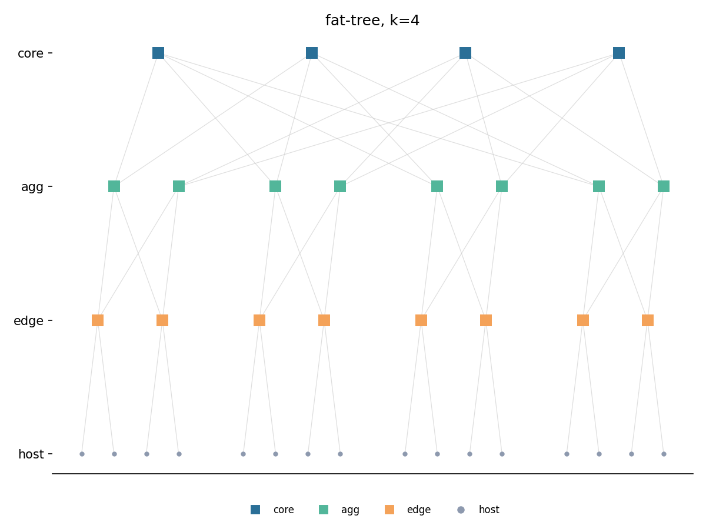
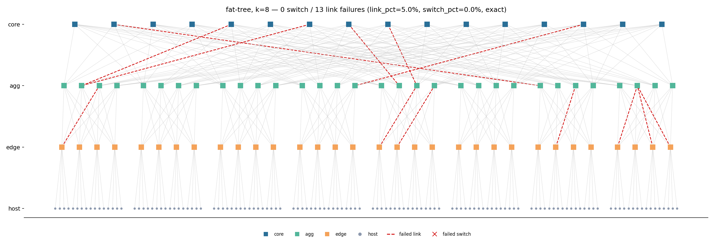
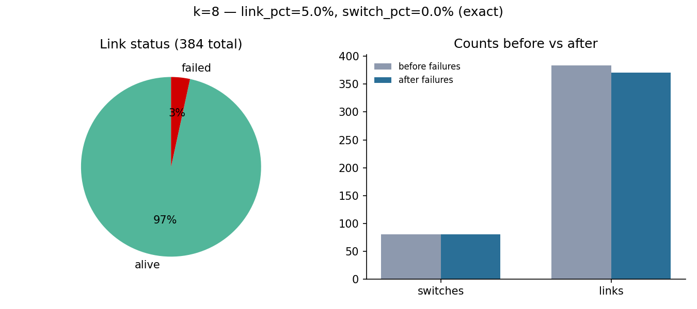
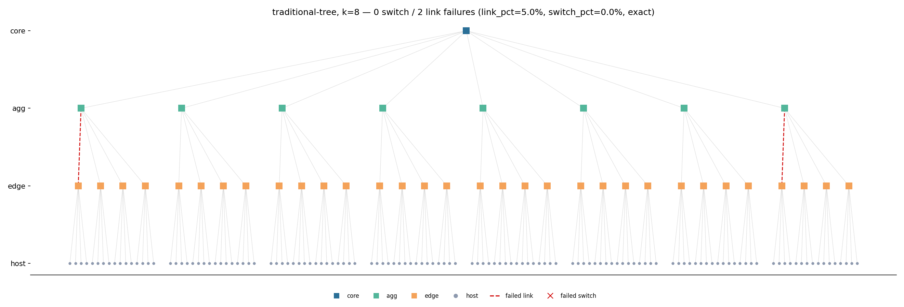
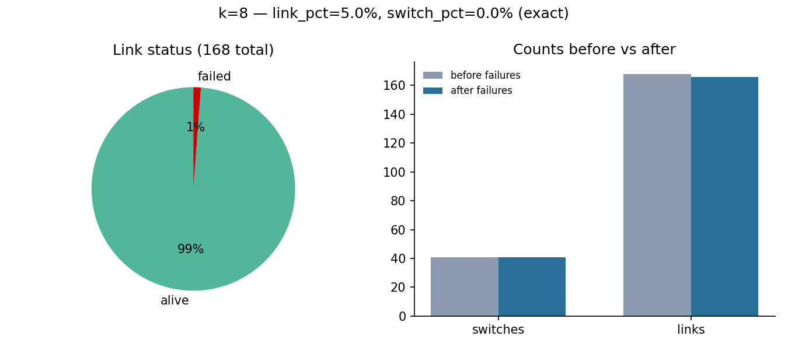
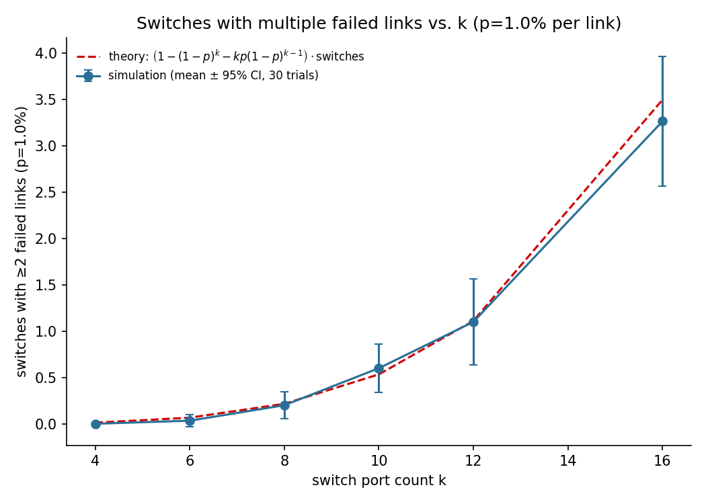

# Fat-Tree Network Topology

Homework 1, course 361.2.2460 — Data Center & AI Networking (BGU, semester A 2026/27).

Implements and analyzes a three-tier fat-tree data center topology, consistent with:

> M. Al-Fares, A. Loukissas, A. Vahdat, "A Scalable, Commodity Data Center Network
> Architecture," SIGCOMM Comput. Commun. Rev., vol. 38, no. 4, pp. 63–74, Oct. 2008,
> doi:[10.1145/1402946.1402967](https://doi.org/10.1145/1402946.1402967).

## Approach

This is a **flow-level graph simulation**, not a packet-level emulator (the paper's
evaluation used Click; this project does not). The topology, addressing, and failure
model are built on top of [networkx](https://networkx.org/): switches and hosts are
graph nodes, links are edges, and failures are modeled as node/edge removal. Routing
and flow-level traffic/throughput analysis are layered on top of the resulting graph.

The topology generator (`fattree/topology.py`) reproduces the paper's three-tier
structure (core / aggregation / edge / hosts) and its IP addressing scheme (Sec. 3.2),
including the agg-switch-to-core-row connection rule and the Fig. 3 worked example,
which are both covered by `tests/test_topology.py`.

## Repository layout

```
fattree/
  topology.py   # build k-ary fat-tree + traditional tree, paper addressing, validate()
  failures.py   # link + switch failures, per layer, exact/bernoulli, fixed or randomized pct
  config.py     # config loading, defaults, validation
  metrics.py    # switches-with-failed-links metric + closed-form theory
config/
  default.yaml  # one scenario
run.py          # CLI: build a topology, apply failures, print a summary
visualize.py    # CLI: topology diagram, failure summary chart, sweep plot
analysis.py     # CLI: run the k-sweep experiment below, write results/*.csv + figures/*.png
figures/        # PNG diagrams and plots (committed)
results/        # CSV sweep output (committed)
tests/          # pytest: topology facts, failures, config, metrics
```

Planned for Phase 2 (full submission, see `CLAUDE.md`): `traffic.py`, `routing.py`,
the rest of `metrics.py` (§6's full list), the `web/` GitHub Pages site, and
additional result plots/discussion.

## Topology diagram

```bash
python visualize.py --k 8 --link-pct 5 --seed 1 --out figures/topology_k8_failures.png
python visualize.py --k 4 --no-failures --out figures/topology_k4_clean.png
```

Layers (core/agg/edge/host) are stacked top to bottom, pods grouped left to right.
Failed links are dashed red; failed switches would be marked with a red ×.

`k=4`, no failures (matches the paper's Fig. 3 worked example):



`k=8`, 5% of edge-agg/agg-core links failed (seed 1, exact mode — 13 of 256 eligible links):



`visualize.py` also writes a small summary chart next to the diagram: a pie of link
status (alive vs. failed) and a bar chart of switch/link counts before vs. after
failure, labeled with the resolved failure percentages:



## Traditional tree (comparison baseline)

`topology.type` (`--topology-type`) also accepts `traditional-tree`: a conventional,
oversubscribed 3-tier tree with the *same host count* as the fat-tree (paper Sec. 2 /
Fig. 1) — one aggregation switch per pod and a single core switch for the whole
network, so there is exactly **one** path between any two hosts, instead of the
fat-tree's `(k/2)²` parallel core paths. Hop counts are identical to the fat-tree
(2/4/6 for same-edge/same-pod/cross-pod); what differs is redundancy, not path length.

```bash
python visualize.py --k 8 --topology-type traditional-tree --link-pct 5 --seed 1 \
    --out figures/topology_traditional_k8.png --summary-out figures/summary_traditional_k8.png
```





With only 5% of links failed, a single unlucky edge-agg link (dashed red, above)
cuts off an entire edge switch's worth of hosts — in the fat-tree diagram above,
the same failure rate barely dents connectivity because every edge/agg switch has
`k/2` parallel uplinks. `tests/test_topology.py::test_traditional_tree_has_no_redundant_paths`
checks this directly by removing one edge-agg link and asserting those hosts become
unreachable.

## Input parameters

Set via `config/default.yaml` (or any `-c <path>`), overridable on the command line.

| Parameter                | Config path            | CLI flag        | Default | Meaning |
|---------------------------|-------------------------|------------------|---------|---------|
| Switch port count          | `topology.k`            | `--k`            | 8       | Even, ≥ 4. Determines every other count: `k³/4` hosts, `5k²/4` switches, `k³/4` links per layer. |
| Topology type               | `topology.type`         | `--topology-type`| `fat-tree` | `fat-tree \| traditional-tree`. The latter is a conventional oversubscribed tree with the same host count, for comparison — see below. |
| Link failure %             | `failures.link_pct`     | `--link-pct` / `--link-pct-range MIN MAX` | 1       | % of links removed. Either a fixed number, or a `[min, max]` range (e.g. `[0, 20]`) to pick a random pct each run, drawn from the seeded RNG so it stays reproducible. |
| Switch failure %           | `failures.switch_pct`   | `--switch-pct` / `--switch-pct-range MIN MAX` | 0       | % of switches removed (with their incident links). Same fixed-or-range option as `link_pct`. |
| Failure layers (links)     | `failures.link_layers`  | —                | `[edge-agg, agg-core]` | Which link layers are eligible to fail. |
| Failure layers (switches)  | `failures.switch_layers`| —                | `[core, agg, edge]`    | Which switch layers are eligible to fail. |
| Failure mode                | `failures.mode`         | `--mode`         | `exact` | `exact` = `round(pct·N)` chosen uniformly without replacement; `bernoulli` = each element fails independently with probability `p = pct/100`. |
| Traffic pattern            | `traffic.pattern`       | `--pattern`      | `random` | `random \| stride \| all-to-all \| incast \| same-pod \| staggered` (Phase 2). |
| Offered load                | `traffic.load`          | `--load`         | 0.8     | Each host sends at `load × link rate` (Phase 2). |
| Routing scheme              | `routing`                | `--routing`      | `ecmp`  | `ecmp \| two-level \| single-path` (Phase 2). |
| Random seed                 | `seed`                   | `--seed`         | 1       | Every random choice is seeded; trial `t` uses `seed + t`. |
| Trials per config point      | `trials`                 | `--trials`       | 30      | Repetitions for Phase 2 sweeps. |

Config and CLI are validated with explicit errors (odd `k`, out-of-range percentages,
unknown pattern/routing/mode, ...) — see `fattree/config.py`.

## Install & run

```bash
python3 -m venv .venv && source .venv/bin/activate
pip install -r requirements.txt

# run the default scenario
python run.py -c config/default.yaml

# override parameters on the command line
python run.py -c config/default.yaml --k 16 --link-pct 10

# randomize the failure pct per run instead of a fixed value (seeded, reproducible)
python run.py -c config/default.yaml --link-pct-range 0 20 --seed 7

# build the traditional-tree comparison baseline instead of the fat-tree
python run.py -c config/default.yaml --topology-type traditional-tree

# machine-readable summary
python run.py -c config/default.yaml --json

# draw the topology + a small pie/bar failure summary chart
python visualize.py -c config/default.yaml --out figures/topology.png --summary-out figures/summary.png

# run the switches-with-failed-links-vs-k experiment (see Results below)
python analysis.py --ks 4 6 8 10 12 16 --p 1 --trials 30 --seed 1
```

Example output:

```
Topology: fat-tree, k=8
  hosts:    128
  switches: 80
  links:    384
  failures: 0 switches, 3 links (link_pct=1%, switch_pct=0%, exact mode)
  after failure: 80 switches, 381 links
```

## Tests

```bash
python -m pytest tests/ -v
```

Covers: topology counts vs. the paper's closed-form formulas (`k³/4` hosts, `5k²/4`
switches, `k³/4` links per layer) for `k ∈ {4, 6, 8}`; the paper's Fig. 3 worked
addressing example; shortest-path hop counts (2/4/6 hops for same-edge/same-pod/
cross-pod host pairs); failure-count correctness and determinism under a fixed seed
(including randomized `[min, max]` failure-pct ranges); config validation/merging;
the traditional-tree baseline's counts, connectivity, and lack of path redundancy;
and the switches-with-failed-links metric against a brute-force enumeration of all
`2^k` failure patterns for small k (see Results below).

## Results

### Switches with multiple failed links vs. switch port count

This is the assignment's "intermediate" example metric (Sec. 5): *"Number of
switches with multiple failed links (at a 1% failure rate) as a function of switch
port count."*

**Setup.** For each `k ∈ {4, 6, 8, 10, 12, 16}`, build a fat-tree and fail each of
its links independently with probability `p = 1%` (bernoulli mode, across all three
link layers so every switch's `k` ports are equally exposed — `--link-layers`
defaults to `edge-agg`/`agg-core` only, but this experiment needs host-edge
included too, since the metric is about a switch's *total* port count). Repeat for
30 seeded trials per `k` (`seed + t`) and take the mean and 95% CI. Compare against
the closed-form prediction (CLAUDE.md §6), since every switch has exactly `k` ports:

```
P(≥2 of k ports fail) = 1 - (1-p)^k - k·p·(1-p)^(k-1)
```

Reproduce with `python analysis.py --ks 4 6 8 10 12 16 --p 1 --trials 30 --seed 1`
→ `results/switches_multifail_vs_k.csv` + the plot below.



**Discussion.** The Monte-Carlo simulation tracks the closed-form curve closely at
every `k`, within its 95% CI — this is both a correctness check on the failure
model (`fattree/failures.py` bernoulli mode genuinely applies independent per-link
probability `p`) and a demonstration of how fast multi-failure exposure grows with
port count. At `k=4` a switch's 4 ports almost never see 2 failures at `p=1%`
(≈0.01 switches network-wide); by `k=16` the same per-link rate yields over 3
switches with ≥2 failed links on average. This matters because a switch with ≥2
failed links is the precursor to a *structural* break: in the fat-tree a single
failed uplink is absorbed by ECMP across the remaining `k/2 - 1` parallel paths,
but a switch losing multiple ports simultaneously shrinks its usable fan-out and
raises the chance that *all* paths through it are gone — which is exactly the
scenario the capacity/oversubscription metrics (planned, §6) will quantify next.
It also explains why larger (`higher-radix`) fat-trees, despite offering more raw
bisection bandwidth, need proportionally more aggressive failure monitoring: the
same per-link failure rate produces a disproportionately larger multi-failure
switch population as `k` grows, since this is a ≈`k²·p²` effect (choose 2-of-`k`
ports, each ∝ `p`).

### Planned (see `CLAUDE.md` §6 for the full list)

- Connectivity: fraction of connected host pairs, isolated hosts, avg. shortest path
  length / stretch, path diversity, diameter — including a fat-tree vs.
  traditional-tree comparison using the new `topology.type` option.
- Capacity: min pod-to-pod max-flow, edge/agg oversubscription after failures.
- Routing/load: link utilization, max link load, throughput vs. ideal, ECMP vs.
  two-level vs. single-path.

## AI usage

This project was developed with AI assistance (Claude, Anthropic), used for:
scaffolding the repository structure, implementing `fattree/topology.py`
(including the traditional-tree baseline), `fattree/failures.py` (including the
randomized `[min, max]` failure-pct ranges), `fattree/config.py`, `fattree/metrics.py`,
`visualize.py`, and `analysis.py` from a specification written by the author (see
`CLAUDE.md`), and writing the accompanying pytest suite (including the brute-force
check of the closed-form multi-failure formula). All formulas, the addressing
scheme, and the failure model were specified by the author with reference to the
paper; the author has reviewed and understands every line submitted and is
responsible for its correctness.

## Status: work in progress

This is the Phase 1 submission, not the final homework. What's solid: topology
generation (fat-tree + traditional tree), failure injection, config/CLI, and the
one worked example above, all backed by passing tests. What's still ahead before
Phase 2 (due 25/10):

- **More bug testing.** The test suite covers the pieces built so far, but hasn't
  been adversarially reviewed, and larger `k` / edge-case configs (e.g. `switch_pct`
  + `link_pct` combined, very large sweeps) are undertested.
- **More analysis metrics.** Only one of the metrics in `CLAUDE.md` §6 has an actual
  experiment and plot; connectivity, capacity (max-flow/oversubscription), and
  routing/load metrics are still just a list, and `traffic.py`/`routing.py` don't
  exist yet.
- **Visual improvements.** The topology diagrams and charts are functional but
  plain — no IP-label tooltips, no interactive web view yet (`web/` per `CLAUDE.md`),
  and the layered diagram gets dense/hard to read for larger `k`.
